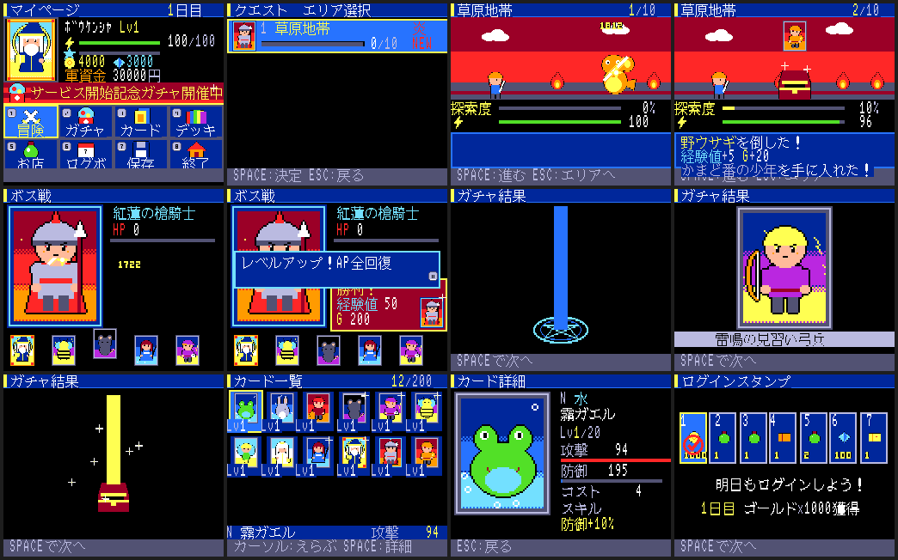
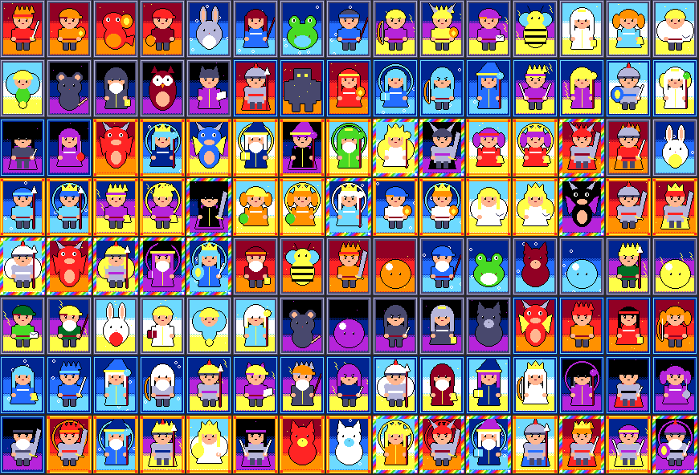
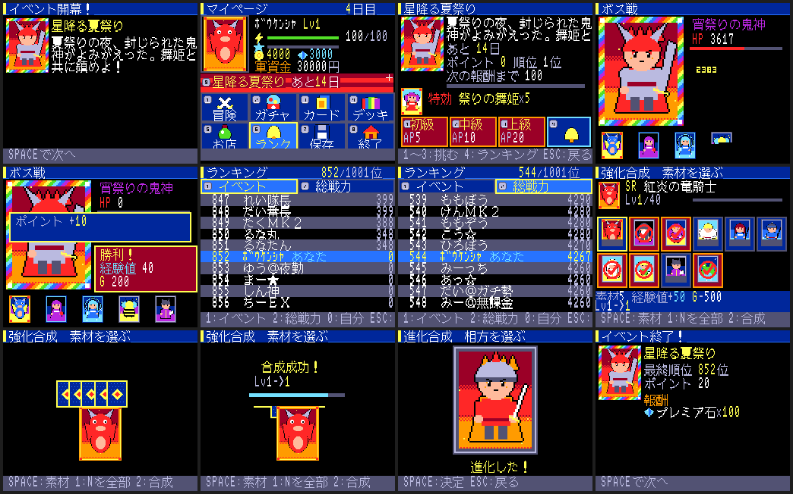
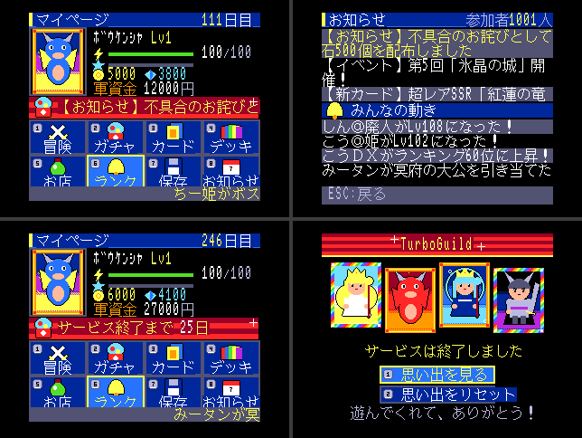

# TurboGuild

MSX turboR 専用の「2011 年頃のソシャゲ文化再現 RPG」。完全オフラインで、
「オンラインっぽさ」（NPC・ランキング・運営年表）はすべてシミュレーションで再現する。

- 企画書: [docs/MSX_turboR_SocialRPG_Design.md](docs/MSX_turboR_SocialRPG_Design.md)
- 実装指示書: [IMPLEMENTATION_SPEC.md](IMPLEMENTATION_SPEC.md)（企画書と矛盾したらこちらを優先）
- 仮決めの記録: [docs/DECISIONS.md](docs/DECISIONS.md)
- ROM ページ割り当て: [docs/MEMORY_MAP.md](docs/MEMORY_MAP.md)

配布形態は **ASCII8 メガROM（フラッシュカートリッジ）＋ セーブ専用フロッピー**。

## 必要なもの

- SDCC 4.x（`sdcc`, `sdasz80`）、Python 3.11+（絵の生成に Pillow）、gcc、GNU make
- openMSX（動作確認は 21.0）と Panasonic FS-A1ST のシステムROM
  （`~/.openMSX/share/systemroms/` に置く。リポジトリには含めない）

## ビルドと実行

```bash
make
```

```bash
make run
```

`make` で `bin/TurboGuild.rom`（512KB, ASCII8）と `bin/save.dsk`（空の 2DD）ができる。
`make run` は FS-A1ST（FDD 付き）で ROM とセーブディスクを挿して起動する。
手で起動する場合は `-romtype ASCII8` を必ず付ける:

```bash
openmsx -machine Panasonic_FS-A1ST -carta bin/TurboGuild.rom -romtype ASCII8 -diska bin/save.dsk
```

## 自動確認

| コマンド | 確認すること |
|---|---|
| `make test` | `core/`（rng・time・save）の PC 単体テスト |
| `make check` | ヘッドレス起動 → 各試験画面のスクショ → 保存 → リセット → 再起動で RTC 差分 × 10 が `g_time` に加算される |
| `make check-nodisk` | ディスク無しで起動し、保存しようとすると `NO DISK` を出して続行できる |
| `make check-msx2` | MSX2（C-BIOS）では「turboR 専用」を出して止まる |
| `make play` | 新規開始から 30 分（エミュレータ時間）自動で遊び、保存→リセット→読み込みで進行が一致するか。イベント参加・合成・期間をまたいだ読み込みの終了処理も確認する。`DURATION=秒` `TRACE=1` |
| `make check-offline` | 1 週間あけて「つづきから」を選び、マイページが出るまで 3 秒以内か |
| `make check-timeline` | ゲーム内の日付を 0〜271 日目まで進め、イベント 7 本の参加と終了、110 日目の贈り物、終了の告知、サービス終了後のタイトルまで通す |
| `make sim` | 経済シミュレーション（PC）。課金コースごとに 270 日遊んで SSR の枚数を数える。受け入れは「課金しない人の中央値 1〜3 枚」（DECISIONS #61） |

結果は `build/run*/check.txt` とスクリーンショット `build/run*/*.png`。
openMSX の後始末は自分の実行ディレクトリのパスで絞って行う（`pkill -f openmsx` は使わない）。

## 遊び方



| キー | 操作 |
|---|---|
| カーソル / ジョイスティック | 選ぶ |
| 数字キー 1〜8 | 携帯の数字キーのように、ボタンの左上の番号で直接選ぶ |
| SPACE / RETURN / トリガA | 決定・探索で「進む」 |
| ESC / トリガB | 戻る（名前入力では 1 文字消す） |

タイトル →（はじめから）名前 → お財布（軍資金のコース）→ 最初の 10 連（何度でも引き直せる）→ マイページ。
マイページから 冒険（探索）・ガチャ・カード（[1] 強化合成 [2] 進化合成）・デッキ・お店・ランク・保存。
イベント開催中はバナー（[9]）からイベントへ。初級・中級・上級のボスを倒してポイントを貯め、報酬ラインと最終順位で報酬がもらえる。
探索は「進む」を押すたびに 1 ステージ進み、探索度 100% でボス戦。
軍資金で石を買い（課金）、石でプレミアガチャや回復薬を買う。ゲーム内で月が変わると給料が入る。無敵モードなら減らない。
ゲーム内の時間は現実の 10 倍で進み、AP は現実 5 分で 1 回復、ゲーム内の日付が変わるとログインボーナス。
タイトルで ESC を押すと Phase0 の診断画面に入る。

### 画面づくりの考え方（2010〜2012 年頃の携帯ソシャゲ）

当時の携帯版は「十字キーでリンクを選び、色反転や囲みで選択を示す」「数字キー（accesskey）で直接選べる」
「1 画面は 13 文字 × 10 行ほどの文字と小さな画像・バナー」「リッチな部分（ガチャ・バトル・強化）は Flash 演出」
「決定を押したらあとは見ているだけの自動戦闘」「スタミナで探索・ボス」「マイページ中心」だった。
本作はこれを「絵が主役、文字は添え物」に置き換えている（docs/DECISIONS.md #31〜#38）。
調べた資料: [CEDEC 2011 グリーの講演記事（ファミ通）](https://www.famitsu.com/news/201109/09049960.html)、
[『探検ドリランド』開発者インタビュー（電ファミ）](https://news.denfaminicogamer.jp/interview/200406d/3)、
[ドリランドの思い出（ねとらぼ）](https://nlab.itmedia.co.jp/cont/articles/3293848/)、
[携帯サイトのアクセスキー（All About）](https://allabout.co.jp/gm/gc/24002/2/)。

ガチャは種類ごとに違う開封演出で、光の色が出た中で最も高いレアリティを示す:

| ガチャ | 演出 |
|---|---|
| 無料 | カプセルマシンのハンドルを回し、カプセルが転がり出る |
| ゴールド | 宝箱が揺れて開き、光が立ち上る |
| プレミア | 魔法陣が明滅して光の柱。SSR なら虹色に変わり画面が白く光る（確定演出） |
| チケット | 巻物が広がる |
| SR 確定 | 黄金の扉が開いて白い光があふれる |

カードの絵（65 枚、手続き生成。図は Phase 1.5 時点の 40 枚）: 

## Phase 0 の状況

| 項目 | 状態 | 確認方法 |
|---|---|---|
| `make` で ROM、`make run` で turboR + FDD が起動し SCREEN5 に「TurboGuild」 | 済 | `make check` の `title.png` |
| H.STKE 方式で起動し、HIMEM と空き RAM を表示 | 済 | 診断画面。実測 HIMEM=DE67h、C000h〜HIMEM = 7,783 B |
| バンク切替テスト画面（全ページの見出しを 3 つの窓で照合） | 済 | `bank.png`: 31/31 OK × 3 窓 |
| `sys/` 各モジュールの最小実装と動作確認 | 済 | ROM 内の試験画面で代替（DECISIONS #4） |
| `build_data.py` → `link_rom.py` でカードを ROM から読む | 済 | `cards.png` |
| `tests/` で `core/rng.c` と `core/time.c` が gcc で通る | 済 | `make test` |
| セーブ → リセット → ロードで RTC 差分が加算、ディスク無しでも遊べる | 済 | `make check` / `make check-nodisk` |
| turboR 以外では専用メッセージを出して止まる | 済 | `make check-msx2` |

## Phase 1 の状況

| 項目 | 状態 | 確認方法 |
|---|---|---|
| 500 ステージ自動生成、エリア 5 まで遊べる | 済 | `tools/gen_stages.py`。自動プレイでエリア 10（ステージ 92）まで到達 |
| カード 40 枚、デッキ編成、戦闘式 §6 | 済 | `make test`（戦闘・属性・デッキ）、カード画面 |
| AP 回復、回復薬 | 済 | `make test`（AP）、ショップ・AP 不足時の確認 |
| ガチャ（無料・ゴールド・プレミア＋チケット 2 種）、初回 10 連リセマラ | 済 | `make test`（確率・10 連確定・1 日 1 回。天井は DECISIONS #61 で撤廃） |
| ログインボーナス 7 日 | 済 | `make test`（7 日周期・同じ日は 1 回） |
| 新規開始から 30 分遊んで落ちない。セーブ/ロード往復で所持カード・進行が一致 | 済（エミュレータ） | `make play`: 168 クエスト・46 回の保存→リセット→読み込みが全て一致 |
| 同じことを実機（フラッシュカートリッジ＋FD）で確認 | **未** | 実機が要る |

### Phase 1.5（絵が主役の画面・軍資金）

| 項目 | 状態 | 確認方法 |
|---|---|---|
| 全画面を絵とゲージ主体に（マイページ・探索・ボス戦・ガチャ・カード・デッキ・ログボ・お店・タイトル） | 済 | 紹介画像、`make play` |
| ガチャの種類別の開封演出とカードめくり | 済 | コマ撮りで確認 |
| 数字キーで直接選ぶ | 済 | 各画面のボタン |
| 軍資金・課金ショップ・給料日・無敵モード | 済 | `make test`（wallet）、`make play`（課金して 2000 円使う） |
| 30 分の自動プレイ・保存往復の一致 | 済（エミュレータ） | `make play`: 522 クエスト・40 回の保存→リセット→読み込みが一致 |

### Phase 2（合成・進化・イベント・ランキング）



| 項目 | 状態 | 確認方法 |
|---|---|---|
| 合成・進化 §7、一括素材選択（[1] N を全部） | 済 | `make test`（経験値・同レア +50%・最大 Lv・デッキは素材不可・進化）、画面はカード詳細の [1]/[2] |
| イベント kind=0 を 1 本、14 ゲーム日で開始→終了→報酬配布まで自動 | 済 | `make test`（開幕・報酬ライン・特効・終了・順位報酬・2 度目は何も起きない） |
| ランキング（NPC は静的データ） | 済 | `make test`（順位・一覧の並び）、マイページの [6] とイベント画面の [4] |
| **受け入れ**: イベント期間をまたいだセーブを読み込むと、正しく終了処理と報酬が走る | 済（エミュレータ） | `make play`: 3 日目に参加して戦い、保存→リセット→「20 日目」として読み込み → 最終順位と順位報酬を確認（`EVENT END OK`） |

### Phase 3（運営年表・NPC・お知らせ・FM 音源）



| 項目 | 状態 | 確認方法 |
|---|---|---|
| 運営年表（`data/timeline.csv`）で 0〜270 日目を動かす。お知らせ・イベント 7 本・確率アップ・インフレ・贈り物・引退の波・終了の告知・サービス終了 | 済 | `make test`、`make check-timeline` |
| インフレと新 SSR はデータだけで足す（カードの `release_day`、世代ごとの強さは年表のインフレから自動で決まる） | 済 | `make test`（未登場のカードはガチャ・ドロップに出ない） |
| NPC 1000 人の成長・引退・イベントポイントを式で決める。ランキングは毎回並べ直す。マーキーと「みんなの動き」に流れる | 済 | `make test`、マイページの [6]・[8] |
| FM 音源（OPLL）の BGM 5 曲（マイページ・冒険・ボス・ガチャ・イベント） | 済 | `make run` で聴く |
| **受け入れ**: 課金しない人のサービス終了時の SSR が 1〜3 枚（仕様の 3〜8 枚から下げた） | 済 | `make sim`（中央値 1 枚） |
| イベントガチャは BOX ガチャ（100 個入り・SSR 1）。天井なし・SR 確定チケットは SR だけ・イベントの SSR は 10 位以内の報酬だけ | 済 | `make test`（引き切ると中身どおり・次の箱・イベントが替わると 1 箱目） |
| **受け入れ**: 1 週間ぶりの起動でマイページまで 3 秒以内 | 済（エミュレータ） | `make check-offline`（2.66 秒） |

`make sim` の結果（各 30 回、270 日）:

| コース | SSR 中央値 | 範囲 | 課金(円) |
|---|---|---|---|
| 課金しない | 1 | 0〜2 | 0 |
| おこづかい | 2 | 0〜4 | 27,000 |
| 社会人 | 9 | 5〜13 | 118,000 |
| 石油王 | 14 | 11〜17 | 232,000 |

課金しない人の 4 割は SSR 0 枚で終わる（当時の無課金の感覚）。無敵モードは石油王と同じ引き方なので同じ結果。

既知の課題:
- 数値は `make sim` で一度合わせただけ。遊んでみて調整する。
- 文字描画は C で書いていて遅い（名前入力の全面描画で 1 秒弱）。体感が悪ければ RAM 実行の asm に置き換える。
- BGM はメインループで鳴らしているので、長い描画やディスクの読み書きの間は止まる。

## 構成

```
src/sys/   ハード依存（crt0・VDP・文字・漢字ROM・入力・PSG・RTC・ディスク・バンク・中継）
src/core/  ゲームロジック（ハード非依存。PC でテストする）
src/ui/    画面（Screen 表）・共通部品・セーブディスク管理
src/data/  生成ヘッダ（手で編集しない）
data/      元データ（UTF-8 の CSV）
tools/     Python ビルドツール
openmsx/   自動確認用 Tcl
```

## 踏んだ地雷（再発させない）

- **REDCLK はメインROMではなく SUB-ROM のエントリ（01F5h）。** メインROMの 01F5h を直接
  `call` すると RDSLT の内部に飛び込み、ページ3 がカートリッジに切り替わって暴走する。
  `ld ix,#0x01F5 / call EXTROM` で呼ぶ。他の SUB-ROM ルーチンも同様。
- **VDP コマンド（HMMV）が走っている間に CPU で VRAM へ書くと、後からコマンドに塗りつぶされる。**
  文字描画の前に S#2 の CE を待つ。
- **SCREEN5 の色 0 は既定で透明**で、周辺色（R#7）が見える。R#8 の TP を立てる。
- **セーブ構造体（882 B）をセクタ単位（512 B × 2）で直接読み書きすると、後ろの RAM 変数まで
  保存・復元される。** リセットしたのにメニュー位置が前回のまま、という形で出た。
  1 セクタずつ `g_sector` 経由でコピーする（`src/ui/savedisk.c`）。
- **起動時に画面部品のアトラスを VRAM に読み込み忘れると、部品が全部ただの四角になる**（`gfx_load_atlas()`）。
- SDCC は小さな定数同士の足し算（124+8 など）を char で畳み、127 を超えると誤検知の警告 158 を出す（値は正しい）。
- SDCC の `--codeseg BANK1` が作る領域名は `_BANK1`。リンカには `-Wl-b_BANK1=0x16010` のように書く。
- **SDCC は別バンクの関数を直接 `call` してもリンクを通す**（24bit 番地の下位 16bit で命令を作る）。
  実行すると今の窓の中の別物に飛ぶ。`FAR` の中継を通し、`tools/check_banks.py` で検査する。
- **EXTROM（CALSLT）は割り込み禁止のまま戻る。** RTC を読んだあと `ei` しないと、
  何も描かない待ち画面で JIFFY が止まり、フレーム待ちで永久に固まる（自動プレイで発覚）。
- 自動テストの「いま押してよいか」の判定に、毎フレーム一瞬しか立たない状態を使うと、
  サンプリングでは見えない。押下待ちの間ずっと立てておく（`g_ui_state`）。
- openMSX の Tcl で `after` から呼ぶ手順に空の要素を混ぜると「invalid command name ""」で
  連鎖が無言で止まる。
- **Z80 で u32 の割り算・掛け算（`__divulong` / `__mullong`）を NPC 1000 人ぶん回すと、起動が 9 秒かかった。**
  プロファイルで見つけ、シフトと足し算に書き換えて 2.66 秒にした。毎回回す式に `%` と `*` を書かない。
- **xor とシフトだけのハッシュは線形なので、種を変えても判定どうしが相関する。** 種を 100 と 101 にしたら
  引退する NPC が極端に少なく、離れた種にしても 2 回目の引退の波が 30% のところ 39% 当たった。
  足し算を混ぜて線形を崩す（`src/core/ranking.c` の `hash`）。
- openMSX は `set throttle off` のままだと `screenshot` が古いフレームを返す。撮るときだけ on にする。
- 画面の init の途中で「押下待ち」の状態が残っていると、自動試験が前の画面の待ちと見誤って押してしまう。
  画面を替えるときに BUSY にする（`apply_change`）。

## カートリッジへの書き込み（実機）

ASCII8 対応のフラッシュROMカートリッジに `bin/TurboGuild.rom` を **マッパ種別 ASCII8** を
指定して書き込む。セーブ用に物理フォーマット済みの 2DD フロッピーを A ドライブに入れる。
**このディスクはゲーム専用**（DOS でファイルを書き込むとセーブ領域を壊す）。
