<!-- SPDX-License-Identifier: MIT -->
# TurboGuild

<p align="center">
  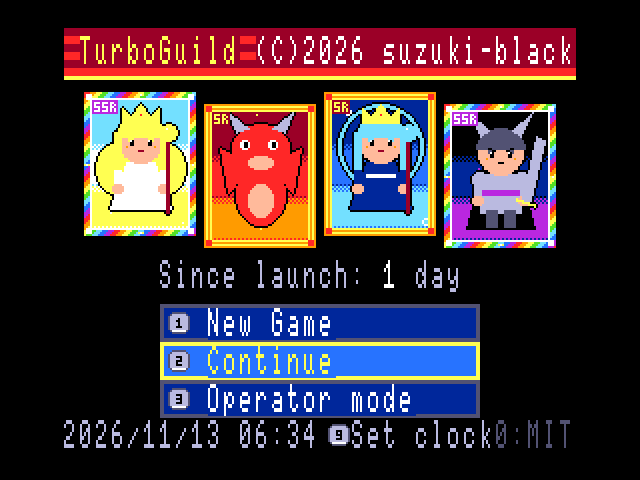
</p>

> ⚠️ **This is a prototype** (work in progress), published for feedback and experimentation.
> It has had little play-testing; numbers and balance will change.
> **On real hardware, always use a floppy you do not need as the save disk.**
>
> ⚠️ **試作品（プロトタイプ・開発中）です。** フィードバックと実験のために公開しています。
> テストプレイはまだ十分ではありません。数値やバランスは今後変わります。
> **実機では、セーブ用のフロッピーに必ず要らないディスクを使ってください。**

**Original concept / game design / direction:** suzuki-black　/
**Implementation (program, graphics, sound):** Claude Code (Anthropic Claude)
<br>**原案・コンセプト・ゲームデザイン・ディレクション:** suzuki-black　／
**実装（プログラム・グラフィック・サウンド）:** Claude Code（Anthropic Claude）

**Repository / リポジトリ:** <https://github.com/suzuki-black/TurboGuild> ·
**Latest / 最新:** v0.3.1

<p align="center">
  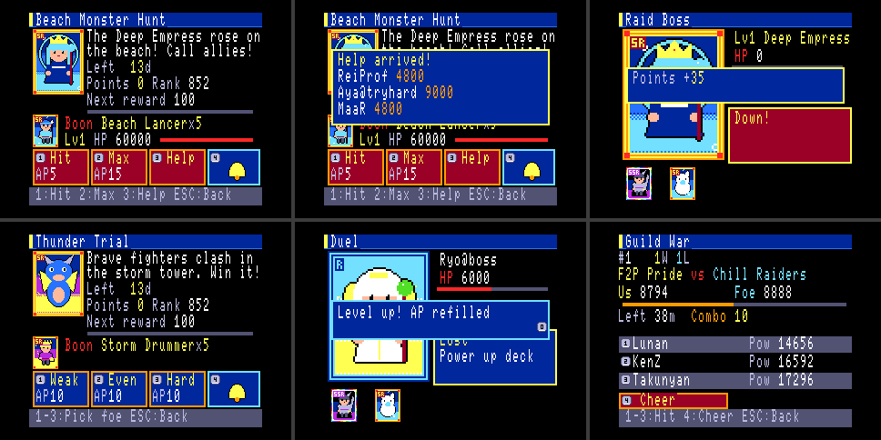
</p>

**Language / 言語:** [🇬🇧 English](#english) · [🇯🇵 日本語](#japanese)

---

<a name="english"></a>
## English

- [Story](#story)
- [What it is](#what-it-is)
- [The people](#the-people)
- [The social-game loop](#the-social-game-loop)
- [Time](#time)
- [After the end](#after-the-end)
- [Operator mode](#operator-mode)
- [Your first hour](#your-first-hour)
- [Controls](#controls)
- [Requirements](#requirements)
- [Building](#building)
- [Running](#running)
- [Automated checks](#automated-checks)
- [Project structure](#project-structure)
- [Documentation](#documentation)
- [How it got here](#how-it-got-here)
- [Scope & honest positioning](#scope--honest-positioning)
- [Feedback](#feedback--contributing)
- [Credits](#credits)
- [License](#license)
- [Disclaimer](#disclaimer)

### Story

> You are a rookie adventurer walking through the doors of an adventurers' guild.
> The notice board offers daily login bonuses, limited-time events, and a banner that reads
> "SSR rates UP!". At the next table, strangers level up, climb the rankings, and one day quietly vanish.
> This world has an end date — day 270 after launch.
> What kind of adventurer will you be by then?

### What it is
- **An MSX turboR game** (an 8 Mbit (1 MB) ASCII8 MegaROM, plus a 2DD floppy used only for saves).
- **A single-player RPG that recreates the Japanese feature-phone social games of around 2011** — and, more than
  the game systems, the people around you in them: guild mates who chat, slack off, quit; a rival one step above;
  someone who steals your card while you sleep.
- **Fully offline.** Everything that feels "online" — 1,000 other players, rankings, operator news, events,
  guild wars, the guild board — is worked out from the in-game date. Nothing is fetched from anywhere.
- **Time runs 10× faster than real time**, and the service closes on day 270 (27 real days). Stay away as long as
  you like: what happened meanwhile is waiting when you come back. Or skip ahead at the inn.

### The people
- **The guild board.** Each guild has seven or eight mates with a payment style and a verbal tic. Four times an
  in-game day one of them may post — about the current event or guild war, a new rarity, work, school, payday,
  the weekend, a terrible pull, a lucky SSR. They reply to each other ("> Koun: So true"), cheer up a mate who
  sounds tired, see off one who leaves, and later miss them. They react to you by name, too: your SSR, a card stolen
  from you, passing your rival, a level-up, a guild war win, a high event rank, coming back after a few days, a night
  at the inn. As the months pass, some sound tired, and one day the board only says they have left the guild —
  and it gets quieter. Open it from News (SPACE); posts also run on the My Page marquee.
- **How mates leave.** Each mate who quits has a reason — exams, a new job, marriage, parents finding out, boredom,
  another game, a ban, a new phone that lost the data — and their last posts and how the others remember them depend
  on it. Some simply stop coming; weeks later the guild master (marked ★) removes them. When the master quits, the
  next mate takes over — and if nobody is left, you do. About one in ten comes back once for three days. Half of
  those who say goodbye leave you a card.
- **Small moments.** The game's calendar starts on 1 July 2011: mates talk about Obon, Christmas and New Year, and
  celebrate each other's birthdays. Visitors from other guilds drop in to try it out and never come back; now and
  then the master suggests an offline meetup, and the board goes quiet that evening. Each mate writes in their own
  style (half-width kana, small vowels).
- **Members, mail and footprints.** On the board, 1 shows the member list with levels and last logins (SPACE for a
  profile: payment style, verbal tic, birthday). News 2 shows who visited your My Page — a thief leaves footprints too
  — and News 3 opens your mail: the master's welcome, the reason a mate couldn't write on the board, letters after
  the end.
- **A rival.** The player just above you in the ranking becomes your rival until you pass them. My Page shows the
  gap; they react when you pass them (during an event they may promise to pass you back on the last day), and the
  marquee tells you whether your pace will catch them by the last day.
- **Stealing.** While you are away, players near your power steal cards that are in none of your decks — a small
  chance every six in-game hours, up to three each time you come back, more often as your guild mates leave (the
  ones who stay keep watch). My Page tells you who took what. Press 0 on My Page to spend 20 AP and go stealing:
  take your card back from the thief (at its old level), or steal from a weaker (N), an equal (R) or a stronger (SR)
  player. A thief who has quit the game cannot be found any more.
- **1,000 players.** They level up, pull SSRs, climb the rankings and quit in waves along the operations timeline,
  all from formulas. The news marquee shows who pulled an SSR, who leveled up, who logged in.

<p align="center">
  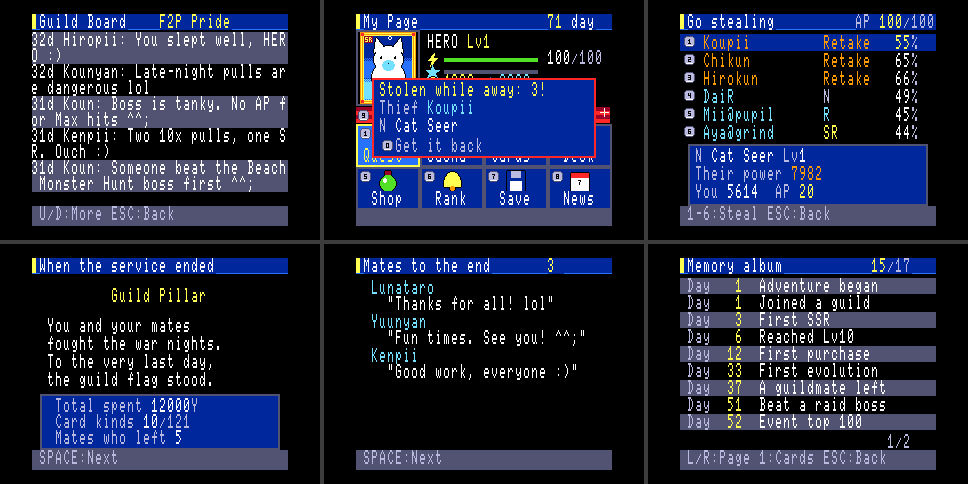
</p>

### The social-game loop
- **The feel of the era's phones:** menus picked with number keys, a "My Page" hub, a scrolling marquee,
  auto-battles you watch, and stamina (AP) for exploring.
- **Gacha with a different opening for each type** (capsule machine, treasure chest, magic circle, scroll, golden
  door) — read the rarity from the light. Events use a **box gacha** (100 items per box). There is no pity system.
- **War funds** instead of real money: an in-game wallet (allowance, salaried worker, oil baron, or infinite) buys
  gems. Paying makes you stronger — the social-game logic, without the real cost.
- **121 cards** (procedurally drawn), enhancement and evolution fusion, three decks.
- **Before a fight:** Normal, Save (half AP, 60% attack) or All-out (double AP, 250% attack) — the rewards are the
  same. The deck's first card is the leader (+20% attack for cards of its element). Fire, water and thunder beat
  each other in a circle; light and dark beat each other (120% / 80%). The screen shows the enemy's weakness, and
  one key builds the deck for it (event boon cards included).
- **Three event types:** hunt (repeatable bosses), **raid** (a boss whose HP stays until it falls; call your guild
  for backup) and **battle** (pick a weaker, equal or stronger opponent).
- **Guild wars:** a week of one-hour battle windows at 12:00 and 21:00 — attack the other guild, build combos, cheer.

### Time
- **10× real time.** 27 real days are 270 in-game days. Saves record the real clock; when you return, events,
  guild wars, paydays and thefts are settled at once ("Continue" after a week away: about 2.3 s to My Page).
- **The inn** (shop, item 4): **sleep** for 100 G to wake at 6 a.m. the next day with full AP, or **wait** for free
  until the next thing on the calendar — the next guild war battle or the start of the next event — shown before
  you choose; AP only recovers for the time that passed. On the last day it can take you to the final hour.
- **Maintenance** every two weeks (13:00–15:00) and some emergency ones on event start days; you can't enter until
  it ends, it is sometimes extended, and apology gems follow. Payday also brings your monthly bill, and News shows
  how many players are online right now.
- **The clock.** The title shows the MSX's clock with **[9] Set clock**. If the clock looks wrong at boot (before your
  last save, more than 30 days after it, or out of range), it turns red and time away is not counted until you set
  it — a turboR without a clock battery comes up with a random date.
- **The operations timeline:** rate-up campaigns, inflation (newer cards are stronger), apology gems, waves of
  players quitting, **USR** on day 90 and **XUSR** on day 180 (older rarities become common; event bosses are tuned
  for the newest), the end-of-service notice — and the shutdown.

<p align="center">
  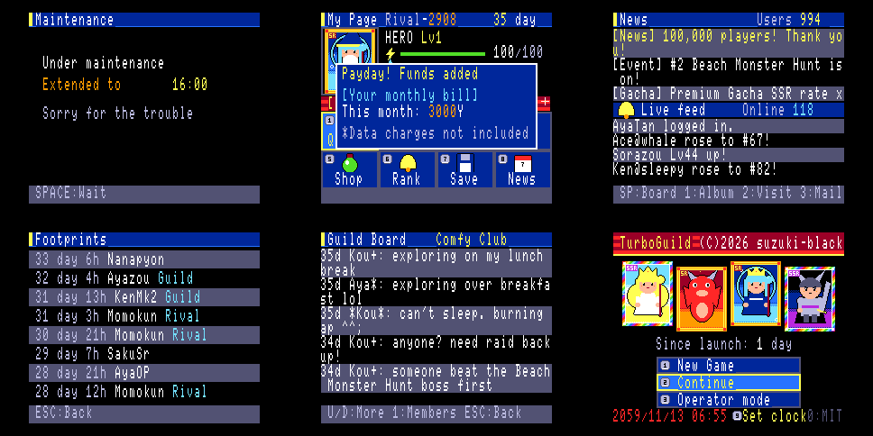
</p>

### After the end
- **The last hour:** from 23:00 on the last day, the mates still there post every five minutes; keep the board open
  and it scrolls by itself until the connection drops at midnight.
- **An ending that depends on how you played:** one of six short endings by total spending, how many kinds of cards
  you own, whether any guild mate stayed, and guild war wins — then the mates who stayed to the end and their last
  words, and the staff roll.
- **A memory album:** sixteen firsts with their day (first SSR, first purchase, first evolution, passing your rival,
  being passed back, a guild war win, a theft, being there on the last day, ...) plus the day a guild mate first left.
  Open it any time from News (1), and from the title after the end. After the end, 3 there opens the mates' last
  letters and 4 an encyclopedia-style article about TurboGuild, partly written from your save. The title itself
  ages with real time: refunds, then refunds closed, then a 404, then another company's ad.

<p align="center">
  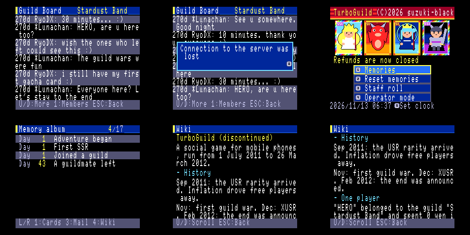
</p>

### Operator mode
Title, 3 — open from the start. Run the same 270 days from the other side.
- **Fast or Full.** Fast is the meetings only (about 2 minutes). Full adds sixteen daily calls: server trouble (how
  to announce the maintenance, how many gems to give), support mails from players in the model (missing gems, a
  child's purchase, a hacked account, a thank-you) and the CEO's sudden ideas. They hit dissatisfaction, logins and
  sales directly — cold answers earn more and lose players.
- **Twelve meetings** at the timeline's turning points: drop rates, pity, ad budgets with a CVR cutoff, rate-ups,
  platform promotion, new rarities, apology gems. Option 1 is what history did; **until you finish the main game,
  the "history" lines are hidden as "???"**.
- **Planning meetings** every 15 days, five cards each: skip, an event (raid boss, East-West guild war, anime
  collab, ranking), a gacha (step-up, multi-tier box, complete gacha, a rerun), monetization (monthly pass, lucky
  bag, rewards for payers only) or a squeeze (quietly cut the odds, remove the pity, skimp on apology gems).
  Complete gacha is banned by industry self-regulation on day 200; rigged odds get exposed sooner or later.
- **A graph of 1,000 NPCs:** DAU, new players, the paying rate, quits and sales. After you finish the main game,
  history's DAU and sales are drawn as dotted lines. On day 240, profit and DAU decide whether the service goes on.
- **At the end:** the results, a report card (peak DAU, the worst day for quitting, gems given, who was left) and one
  of six operator endings. Office chat runs at the bottom of the screen every 15 days.

<p align="center">
  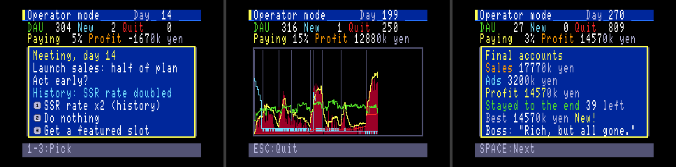
</p>

### Your first hour
1. **Title → New game.** Enter a name, pick a wallet course, and do your first 10-pull (re-roll as often as you like).
2. **My Page** is home: 1 quest · 2 gacha · 3 cards · 4 deck · 5 shop (and inn) · 6 ranking · 7 save · 8 news.
   During an event or guild war, 9 opens it from the banner.
3. **Quest (1):** pick an area and press SPACE to advance. 0 switches Normal / Save / All-out; 6 builds a deck
   for the enemy.
4. **Check the board:** News (8) → SPACE. Come back after a gacha or after the inn and see who noticed. On the
   board, 1 shows the members; on News, 2 shows footprints and 3 your mail.
5. **Keep cards you care about in a deck** (any of A–C) — those can't be stolen.
6. **Short on time?** Shop (5) → 4 Inn → wait until the next event or guild war battle.
7. **On real hardware, check the clock** at the bottom of the title; if it is red or wrong, press 9 to set it.

### Controls
| Where | Input | Action |
|---|---|---|
| Everywhere | Cursor keys / joystick | Select |
| | Number keys 0–9 | Pick the button with that number (like a phone keypad) |
| | Space / Return / trigger A | Confirm; "advance" while exploring |
| | ESC / trigger B | Back (deletes a character in name entry) |
| My Page | 0 | Go stealing (and take stolen cards back) |
| | 9 | The running event or guild war |
| Explore / event top | 0 | Battle style (Normal → Save → All-out) |
| | 6 | Build the deck for this enemy |
| Deck | 7–9 | Switch to deck A–C |
| News | SPACE / 1 / 2 / 3 | Guild board / memory album / footprints / mail |
| Guild board | 1 | Members (SPACE: profile) |
| Memories (after the end) | 1 / 3 / 4 | Cards / last letters / wiki article |
| Shop | 4 | Inn: 1 sleep till morning, 2 wait for the next plan |
| Operator mode | 1 / 2 | At the start: Fast / Full |
| | 1–5 / ESC | Pick an option (1 is history, or skip in a planning meeting) / stop (asks first) |
| Title | 3 / 9 / 0 / ESC | Operator mode / set the clock / license screen / developer diagnostics |
| Set clock | ←→ / ↑↓ / 0–9 / SPACE | Pick a field / change it / type the digits (it moves to the next field) / write the clock |

After the service ends, the title offers Memories (the album; 1 there shows your cards), Reset memories, the staff
roll (with the ending), and operator mode.

### Requirements
- **MSX turboR only** (FS-A1ST / FS-A1GT). Anything older shows a "turboR only" message and stops.
- ⚠️ **Always use a floppy you do not need** (one whose contents you can afford to lose) **as the save disk.**
  Saving to a floppy has not been checked on real hardware yet, so never use a disk with files you care about.
- For saving, put a DOS-formatted (FAT12) 2DD floppy in drive A. The save is an ordinary file, `TGSAVE.DAT`
  (4.5 KB, in the root directory), so the disk can hold other files and you can back it up from DOS. On a disk
  without that file, the game asks before creating it (the default is No), and it re-reads the disk before every
  save. Saves from earlier versions load as they are. You can play without a disk (saving is disabled).
- In-game time follows the turboR's built-in clock, shown at the bottom of the title with **[9] Set clock**. **If the
  clock battery is dead**, the clock comes up with a wrong date at power-on. When the clock is before your last save,
  more than 30 days after it, or out of range, the clock turns red and time away is not counted until you set it.
  The clock covers 1980–2079.
- The turboR system ROMs are copyrighted and **not included**. Development and checks use
  [openMSX](https://openmsx.org/) with a machine definition based on dumped system ROMs (Panasonic FS-A1ST).
- **On real hardware**, the game has run on a Panasonic FS-A1ST (from a RAM cartridge), including the clock.
  **Saving to a floppy has not been checked on real hardware yet.**

### Building
Requires SDCC 4.x (`sdcc`, `sdasz80`), Python 3.11+ (Pillow, for the procedural art), gcc, and GNU make.

```bash
make
```

This produces the **English version** `bin/TurboGuild.rom` (an 8 Mbit (1 MB) ASCII8 MegaROM) and `bin/save.dsk`
(a blank 2DD image). For the **Japanese version**:

```bash
make LANG=ja
```

This produces `bin/TurboGuild_ja.rom`. The program is the same; only the text pages and the name-entry table
differ. Every other target (`make run`, `make check`, ...) also takes `LANG=ja`.

#### Translations
- The game text is written in Japanese (`data/`); the English build replaces it from `data/lang/en.tsv`, one per
  line: UI strings (`data/text/ui.txt`) as `T_KEY<TAB>English`, everything else as `Japanese<TAB>English`.
- A missing translation stops the build and lists the strings in `data/lang/en.missing.tsv`.
- A translation may not be wider than the Japanese (full-width characters count as 2 columns), and some places have
  their own limit (card names: 14 columns, ...). Where the screen has room, a `!` in the third column allows more.
- In guild board lines, `%` is the topic (an event name, a rarity, a card), `#` a player's name and `$` yours.
- To add a language, create `data/lang/<lang>.tsv` and build with `make LANG=<lang>`.

### Running
```bash
make run
```

When starting openMSX by hand, always pass `-romtype ASCII8`:

```bash
openmsx -machine Panasonic_FS-A1ST -carta bin/TurboGuild.rom -romtype ASCII8 -diska bin/save.dsk
```

On real hardware, use an ASCII8-capable cartridge: write the ROM to a flash cartridge with the **ASCII8 mapper
type**, or load it into a 1 MB RAM cartridge (it has run on an FS-A1ST this way, from an ESERAMair).

### Automated checks
| Command | What it checks |
|---|---|
| `make test` | PC unit tests for `core/` (gacha, battle, fusion, events, guild war, timeline, rival, the guild board and how mates leave, members and mail, maintenance and footprints, stealing, inn, memories and endings, operator mode with planning meetings and its history table, saves, …) |
| `make check` | Boot → save → reset → reboot; the RTC difference × 10 is added to in-game time |
| `make check-nodisk` | Boots without a disk and carries on when you try to save |
| `make check-msx2` | Shows "turboR only" and stops on an MSX2 |
| `make play` | Plays automatically for 30 minutes (emulated) from a new game; progress matches across save → reset → load |
| `make check-offline` | After a week away, "Continue" reaches My Page within 3 seconds (measured: 2.3–2.9 s) |
| `make check-timeline` | Runs days 0–271: 7 events, 2 guild wars, gifts, the end-of-service notice, the ending and the staff roll |
| `make sim` | Economy simulation: plays 270 days per wallet course and counts cards of SSR or above |
| `make sim-ops` | Operator mode: runs every combination of meeting choices and shows how many keep the service going (`build/sim_ops single` and `plans` compare the planning-meeting moves) |

Results are left in `build/run*/` as text and screenshots.

### Project structure
```
src/sys/   hardware layer (boot, VDP, text, kanji ROM, input, PSG, RTC, disk, bank switching)
src/core/  game logic (hardware-independent; unit-tested on the PC)
src/ui/    screens, shared widgets, BGM driver, save-disk handling
src/data/  generated headers (do not edit)
data/      source data (UTF-8 CSV, text, MML, translations)
tools/     Python build tools (data conversion, procedural art, MML, ROM assembly)
tests/     PC unit tests and simulations
openmsx/   Tcl scripts for the automated checks
docs/      design documents and records
```

### Documentation
(The documents are written in Japanese.)
- **[Design document](docs/MSX_turboR_SocialRPG_Design.md)** — the concept.
- **[Implementation spec](IMPLEMENTATION_SPEC.md)** — specification, data formats, formulas, phase plan.
- **[DECISIONS](docs/DECISIONS.md)** — changes from the spec and provisional decisions, with the numbers behind them.
- **[MEMORY_MAP](docs/MEMORY_MAP.md)** — ROM page allocation (the build assembles the ROM from this table).
- **[Development log](docs/開発記録.md)** — status and checks per phase, and the pitfalls we hit.
- **[CHANGELOG](CHANGELOG.md)** — what changed in each release.

### How it got here
| Stage | Content |
|---|---|
| Phase 0 | Foundation: ASCII8 MegaROM, H.STKE boot, bank switching, kanji ROM, save disk, RTC |
| Phase 1 | Quests, AP, cards, deck, battle, gacha, login bonus |
| Phase 1.5 | Re-researched the era's phone UIs and made every screen picture-first; gacha openings; war funds |
| Phase 2 | Fusion, evolution, events, rankings |
| Phase 3 | Operations timeline, 1,000-NPC pseudo-online world, news, FM music, economy simulation |
| v0.1.0 | Harder gacha (box gacha, no pity), 121 cards, raid and battle events, guild wars, staff roll, FAT12 save disk |
| v0.2.0 | "People over systems": guild board (replies, lives, reactions to you), rival, stealing, endings and the last mates, memory album, operator mode, inn; also element display, battle styles, leader skill, three decks |
| v0.3.0 | How mates leave, the feature-phone air (writing styles, footprints, maintenance, bills), letters and seasons, the last hour and the afterlife of the title, and a much deeper operator mode (planning meetings, full mode, report card, six endings) |
| v0.3.1 | The MSX clock on the title with a way to set it (for a turboR without a clock battery); first run on a real FS-A1ST |

### Scope & honest positioning
This is an **experimental study**.

- **The theme is the atmosphere of social games of that era — above all, the people in them.** Depth as a game
  comes second. The rankings, the news and your guild mates are all "plausibility" generated from formulas.
- **Most numbers are provisional.** The economy was tuned once by simulation (`make sim`); stealing, the inn, the
  endings and most of v0.3's additions have not been tuned by play yet.
- Operator mode runs on a small model of 1,000 NPCs tuned with `make sim-ops`, not on real data from any service.
  Fast mode takes about two minutes for 270 days (emulated turboR); Full mode about twenty.
- **On a real turboR** it has run on an FS-A1ST, clock included. **Saving to a floppy has not been checked there
  yet** — use a disk you do not need.
- A full-screen redraw takes about 0.6 s. Entering a guild war takes about 4 s on My Page (the 16 guilds' strength is
  counted from all 1,000 NPCs once a day).
- The BGM is driven by the VBLANK interrupt. It pauses only during disk access and resumes where it left off.

### Feedback & Contributing
Please use GitHub Issues for bug reports and impressions. Pull requests with a clear scope are welcome.

### Credits
- **Original concept / game design / direction:** suzuki-black
- **Implementation (program / graphics / sound):** Claude Code (Anthropic Claude)
  — card art and UI parts are procedurally generated, and all music is original; nothing is copied from existing works.
- **Tools:** [SDCC](https://sdcc.sourceforge.net/), [openMSX](https://openmsx.org/), Python (Pillow)

### License
**MIT** © 2026 suzuki-black. See [LICENSE](LICENSE). **Everything in this repository — code, graphics,
music and data — is released under the MIT license.** All assets are original works created for this game;
no rights are reserved beyond the MIT terms. Every source file carries `SPDX-License-Identifier: MIT`.

The ROM contains the SDCC runtime library (GPL with a linking exception, so distributing the ROM is fine).

### Disclaimer
- This is a fictional game. All guilds, adventurers (NPCs), operators and events are fictional and have no
  relation to real people, organisations or games. No specific game's names, characters, images or audio are used.
- "War funds", "payments" and "stealing" exist only inside the game. **No real money is involved.**
- MSX is a trademark of MSX Licensing Corporation. Other company and product names are trademarks or
  registered trademarks of their respective owners.

---

<a name="japanese"></a>
## 日本語

<p align="center">
  <br>
  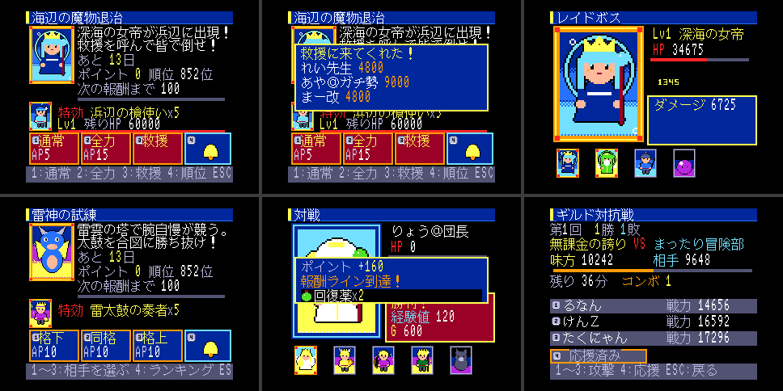
</p>

- [あらすじ](#あらすじ)
- [どんなゲームか](#どんなゲームか)
- [人](#人)
- [ソシャゲの循環](#ソシャゲの循環)
- [時間](#時間)
- [終わった後](#終わった後)
- [運営モード](#運営モード)
- [はじめの 1 時間](#はじめの-1-時間)
- [操作](#操作)
- [動作環境](#動作環境)
- [ビルド](#ビルド)
- [実行](#実行)
- [自動確認](#自動確認)
- [ディレクトリ構成](#ディレクトリ構成)
- [ドキュメント](#ドキュメント)
- [ここに至るまで](#ここに至るまで)
- [位置づけ（正直な自己評価）](#位置づけ正直な自己評価)
- [フィードバック](#フィードバック)
- [クレジット](#クレジット)
- [ライセンス](#ライセンス)
- [免責](#免責)

### あらすじ

> 新人冒険者のあなたは、とある冒険者ギルドの門をくぐった。
> 掲示板には毎日のログインボーナス、期間限定のイベント、そして「SSR 排出率アップ中！」の張り紙。
> 隣のテーブルでは見知らぬ冒険者たちがレベルを上げ、ランキングを駆け上がり、ある日ふっと姿を消していく。
> この世界には終わりの日が決まっている——サービス開始から 270 日目。
> それまでに、あなたはどんな冒険者になっているだろうか。

### どんなゲームか
- **MSX turboR 用ソフト**（8メガビット（1MB）の ASCII8 メガROM ＋ セーブ専用の 2DD フロッピー）。
- **「2011 年頃のガラケーソシャゲ」を再現した 1 人用 RPG。** 再現したいのは仕組みよりも、そこにいた人たちです。
  おしゃべりして、サボって、いつか辞めていくギルドの仲間。ひとつ上のライバル。寝ている間にカードを盗んでいく誰か。
- **完全オフライン。** 「オンラインっぽさ」——ほかのプレイヤー 1000 人、ランキング、運営のお知らせ、イベント、
  ギルド対抗戦、伝言板——は、すべてゲーム内の日付から式で決まります。どこからも何も取ってきません。
- **時間は現実の 10 倍で進み**、270 日目（現実の 27 日）でサービスは終わります。何日空けても、起動すればその間の
  出来事が待っています。宿屋で先へ進むこともできます。

### 人
- **ギルド伝言板。** どのギルドにも、課金コースと口癖を持つ仲間が 7〜8 人います。ゲーム内の 1 日に 4 回、誰かが
  書き込みます——いまのイベントや対抗戦、新しいレア度、仕事・学校・給料日・休日、ひどい爆死、まさかの SSR。
  前の書き込みに返事をし（「＞こうんさん それな」）、弱音を吐いた仲間を励まし、辞める仲間を見送り、のちに懐かしみます。
  あなたにも名前を呼んで反応します: SSR・カードを盗まれた・ライバルを抜いた・Lv アップ・対抗戦の勝ち・イベントの上位・
  久しぶりに来た・宿屋に泊まった。月日がたつと弱音が増える人がいて、ある日「ギルドを脱退しました」とだけ流れ、
  板は少しずつ静かになっていきます。お知らせの画面で SPACE。マイページの流れるお知らせにも出ます。
- **仲間の去り方。** 辞める仲間それぞれに理由があります——受験・就職・結婚・親に見つかった・飽きた・ほかのゲーム・凍結・
  機種変で引き継ぎ失敗。最後の弱音と、後で懐かしむ文が理由で替わります。何も言わずに来なくなる人もいて、数週間後に
  ギルドマスター（★）が整理します。ギルマスが辞めると次の仲間が継ぎ、誰もいなければあなたに回ってきます。
  1 割ほどは 1 度だけ戻ってきて 3 日いて、あいさつして去る人の半分はカードを置いていきます。
- **小さな出来事。** ゲーム内の暦は 2011 年 7 月 1 日から。お盆・クリスマス・正月の話をし、仲間の誕生日を祝います。
  よそのギルドの人が体験で入ってきて、そのまま来なくなります。ときどきギルマスがオフ会に誘い、その夜は板が静かに。
  仲間ごとに書き方があります（半角ｶﾅ・小さい「ぁぃぅ」）。
- **メンバー・メール・足あと。** 伝言板の 1 でメンバー一覧（Lv・最終ログイン。SPACE でプロフィール: 課金コース・
  口ぐせ・誕生日）。お知らせの 2 で足あと（泥棒も付けていきます）、3 でメール（ギルマスのあいさつ、
  板には書けなかったわけ、終了後の手紙）。
- **ライバル。** ランキングで自分のすぐ上の人が、抜くまでライバル（宿敵）になります。マイページに差を出し、抜くと
  相手がひとこと言い（イベント中なら「最終日に見てろよ」と返してくることも）、流れるお知らせで「このペースなら
  最終日に届くか」を伝えます。
- **盗み・盗まれ。** 留守の間に、総戦力の近い人がデッキ（A〜C のどれか）に入っていないカードを盗んでいきます。
  ゲーム内 6 時間ごとに少しの確率で、戻ってくるたびに 3 枚まで。ギルドの仲間が去るほど盗まれやすくなります
  （残っている仲間が見張ってくれる）。誰に何を盗まれたかはマイページで知らせます。マイページの 0 で AP 20 を払って
  盗みに行けます。盗んだ人から取り返す（元の Lv で戻る）か、格下（N）・同格（R）・格上（SR）の誰かから盗むか。
  盗んだ人が引退したら、もう見つかりません。
- **1000 人のプレイヤー。** レベルを上げ、SSR を引き当て、ランキングを駆け上がり、運営年表の波に合わせて辞めていきます。
  すべて式から。流れるお知らせには、誰が SSR を引いた、Lv が上がった、ログインした、が流れます。

<p align="center">
  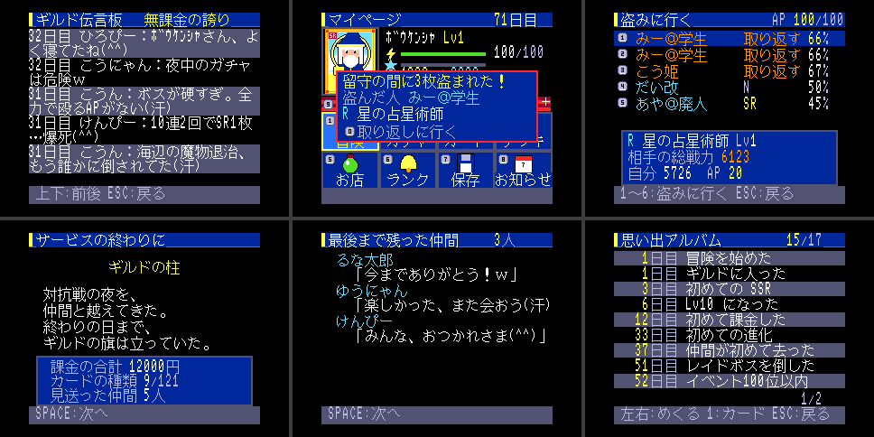
</p>

### ソシャゲの循環
- **当時の携帯の手触り。** 数字キーで直接選ぶメニュー、マイページ中心の画面、流れるお知らせ（マーキー）、
  「決定を押したら見ているだけ」の自動戦闘、スタミナ（AP）制の探索。
- **ガチャは種類ごとに違う開封演出**（カプセルマシン・宝箱・魔法陣・巻物・黄金の扉）。光の色で中身を察する、あの演出。
  イベントは **BOX ガチャ**（100 個入りの箱）。天井はありません。
- **軍資金。** 現実のお金の代わりに、ゲームの中のお財布（おこづかい・社会人・石油王・無敵モード）で石を買います。
  課金すれば強くなる——ソシャゲと同じ理屈を、懐を痛めずに味わえます。
- **カード 121 枚**（手続き生成の絵）。強化合成・進化合成。デッキは 3 つ。
- **戦う前の選択。** 通常・節約（AP 半分・攻撃 60%）・全力（AP 2 倍・攻撃 250%）。報酬は同じ。デッキの 1 枚目が
  リーダー（同じ属性のカードの攻撃 +20%）。炎・水・雷は三すくみ、光と闇は互いに強い（120% / 80%）。画面に敵の
  弱点を出し、キー 1 つでその敵向けに編成します（イベントの特効カードも込み）。
- **イベント 3 型:** 討伐（周回ボス）／ **レイド**（倒すまで HP が残るボス。救援依頼でギルドが削る）／
  **バトル**（格下・同格・格上から相手を選ぶ）。
- **ギルド対抗戦:** 1 週間、毎日 12:00 と 21:00 から 1 時間の「戦の時間」。相手ギルドを攻撃し、コンボと応援で押し切る。

### 時間
- **現実の 10 倍。** 現実の 27 日でゲーム内の 270 日。セーブは現実の時計を覚えていて、戻ってくるとイベント・対抗戦・
  給料日・盗みをまとめて片づけます（1 週間空けて「つづきから」でマイページまで約 2.3 秒）。
- **宿屋**（お店の 4）: **翌朝まで寝る**（100 G、翌朝 6 時に AP 全回復で起きる）か、**次の予定まで休む**（無料。
  次の対抗戦の戦かイベントの始まりまで一気に進む。行き先は選ぶ前に出ます。AP は進んだぶんだけ回復）。最終日は
  「最後の 1 時間」まで休めます。
- **メンテナンス**は 2 週に 1 回（13〜15 時）と、イベント初日の緊急メンテ。終わるまで入れず、ときどき延長し、
  詫び石が届きます。給料日にはご利用料金の明細も。お知らせにはいま冒険中の人数が出ます。
- **時計。** タイトルに本体の時計と **[9] 時刻修正** があります。起動したときに時計がおかしい（前回の保存より前・
  30 日より先・範囲外）と赤くなり、合わせるまで留守の間の時間を数えません。時計の電池が無い turboR は、
  電源を入れるとでたらめな日時になるためです。
- **運営年表:** 確率アップ・インフレ（新しいカードほど強い）・お詫びの石・引退の波・90 日目に **USR**、
  180 日目に **XUSR**（古いレア度ほど出やすくなり、イベントのボスは最新のレア度の前提に）・終了の告知——そしてサービス終了。

<p align="center">
  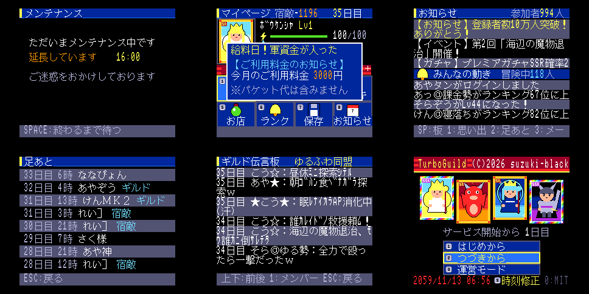
</p>

### 終わった後
- **最後の 1 時間。** 最終日の 23:00 からは、残った仲間が 5 分ごとに書き込みます。伝言板を開いたままにすると
  勝手に流れ、0:00 に接続が切れます。
- **遊び方で変わる結末。** 課金の合計・持っているカードの種類・ギルドの仲間が残ったか・対抗戦の勝ちで 6 通りの
  短い結末が出て、最後まで残った仲間とその別れの言葉、そしてスタッフロールへ。
- **思い出アルバム。** 16 の「初めて」（初めての SSR・初めての課金・初めての進化・ライバルを抜いた・抜き返された・
  対抗戦の勝ち・盗まれた・最終日にいた など）を日付つきで残し、仲間が初めて去った日と並べます。
  いつでもお知らせの 1 から、終了後はタイトルから。終了後はそこで 3 を押すと仲間からの最後の手紙、4 でまとめ記事
  （一部はあなたのセーブから書かれます）。タイトルも現実の時間で古びていきます（払い戻し受付中 → 受付終了 →
  404 → 別の会社の広告）。

<p align="center">
  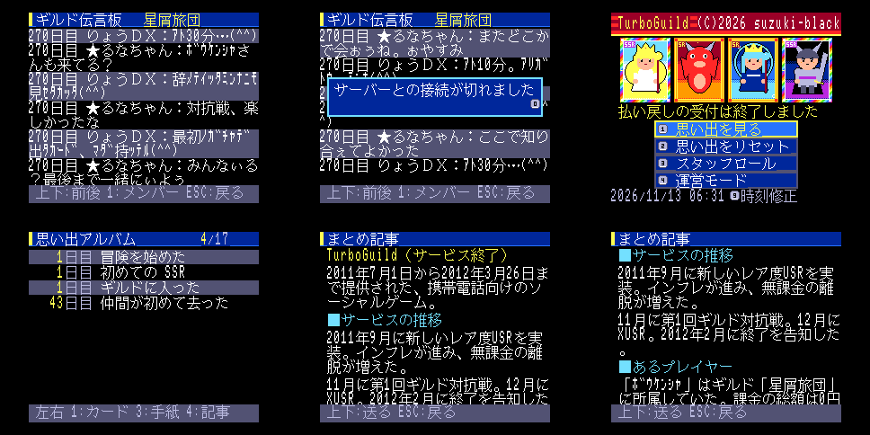
</p>

### 運営モード
タイトルの 3。最初から入れます。同じ 270 日を、運営の側から回します。
- **早回しかじっくりか。** 早回しは会議だけ（2 分ほど）。じっくりでは日々の判断が 16 回来ます——サーバー障害（メンテの
  告知の仕方と詫び石）、模型の中のプレイヤーからの CS のメール（石が減った・子どもの課金・乗っ取り・お礼）、社長の
  思いつき。不満・ログイン・売上に直接効き、冷たく返すほど儲かって人が減ります。
- **12 回の会議**（年表の節目）: 排出率・天井・広告の予算と打ち切りの CVR・確率アップ・一押し枠と相互送客・新しいレア度・
  お詫びの石。選択肢 1 が史実です。**本編を終えるまでは、史実の行は「？？？」で伏せます。**
- **15 日ごとの企画会議**では 5 枚の札から 1 つ——見送る・イベント（レイドボス・東西対抗戦・アニメコラボ・ランキング）・
  ガチャ（ステップアップ・多段 BOX・コンプガチャ・復刻）・課金（月パス・福袋・報酬を課金者だけに）・締め付け（確率を
  こっそり絞る・天井を外す・詫び石を渋る）。コンプガチャは 200 日目に業界の自主規制で廃止になり、絞った確率はいずれ
  検証班にばれます。
- **NPC 1000 人のグラフ:** DAU・新規・課金率・引退・売上。本編を終えた後は、史実の DAU と売上を点線で重ねます。
  240 日目に、利益と DAU でサービスを続けるかが決まります。
- **終わると:** 決算、通信簿（最大の DAU・いちばん辞めた日・配った石・残った人）、6 通りの運営の結末。
  15 日ごとに、画面の下に社内チャットが流れます。

<p align="center">
  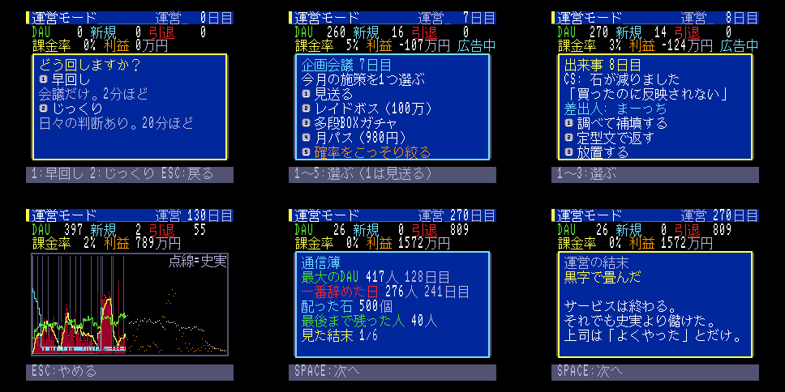
</p>

### はじめの 1 時間
1. **タイトル → はじめから。** 名前を決め、お財布のコースを選び、最初の 10 連（何度でも引き直せる）。
2. **マイページ**が拠点です: 1 冒険・2 ガチャ・3 カード・4 デッキ・5 お店（宿屋も）・6 ランク・7 保存・8 お知らせ。
   イベントや対抗戦の開催中は、9 でバナーから入ります。
3. **冒険（1）:** エリアを選び、スペースで進みます。0 で通常・節約・全力、6 でその敵向けに編成。
4. **伝言板をのぞく:** お知らせ（8）→ スペース。ガチャや宿屋の後にのぞくと、誰かが気づいています。伝言板の 1 で
   メンバー、お知らせの 2 で足あと、3 でメール。
5. **大事なカードはデッキ（A〜C のどれか）に入れておく。** デッキのカードは盗まれません。
6. **待てないときは:** お店（5）→ 4 宿屋 → 次のイベントや対抗戦の戦まで休む。
7. **実機では、タイトルの最下行の時計を見る。** 赤いか、ずれていたら 9 で合わせます。

### 操作
| 場所 | 入力 | 動作 |
|---|---|---|
| どこでも | カーソルキー／ジョイスティック | 選ぶ |
| | 数字キー 0〜9 | ボタンの左上の番号で直接選ぶ（携帯の数字キーのように） |
| | スペース／リターン／トリガA | 決定・探索で「進む」 |
| | ESC／トリガB | 戻る（名前入力では 1 文字消す） |
| マイページ | 0 | 盗みに行く（盗まれたカードを取り返す） |
| | 9 | 開催中のイベント・対抗戦 |
| 探索・イベントのトップ | 0 | 戦い方を替える（通常 → 節約 → 全力） |
| | 6 | その敵向けにおまかせ編成 |
| デッキ | 7〜9 | デッキ A〜C に替える |
| お知らせ | スペース／1／2／3 | ギルド伝言板／思い出アルバム／足あと／メール |
| ギルド伝言板 | 1 | メンバー（スペースでプロフィール） |
| 思い出（終了後） | 1／3／4 | カード／最後の手紙／まとめ記事 |
| お店 | 4 | 宿屋: 1 翌朝まで寝る、2 次の予定まで休む |
| 運営モード | 1／2 | 始めるとき: 早回し／じっくり |
| | 1〜5／ESC | 選ぶ（1 が史実。企画会議では見送る）／やめる（確かめてから） |
| タイトル | 3／9／0／ESC | 運営モード／時刻修正／ライセンスの画面／開発用の診断画面 |
| 時刻修正 | ←→／↑↓／0〜9／スペース | 欄を選ぶ／変える／数字を打つ（桁が埋まると次の欄へ）／時計に書く |

サービス終了後のタイトルには「思い出を見る」（アルバム。そこで 1 を押すと手持ちのカード）・「思い出をリセット」・
「スタッフロール」（結末から）・「運営モード」が出ます。

### 動作環境
- **MSX turboR 専用**（FS-A1ST / FS-A1GT）。turboR 未満では「turboR 専用」と出して止まります。
- ⚠️ **セーブ用のフロッピーには、必ず要らないディスク（中身が消えても困らないもの）を使ってください。**
  フロッピーへの保存はまだ実機で確かめていません。大事なファイルが入ったディスクは使わないでください。
- セーブには、DOS でフォーマットした（FAT12 の）2DD フロッピーを A ドライブに入れてください。セーブはルートの
  ふつうのファイル `TGSAVE.DAT`（4.5KB）なので、ほかのファイルと同じディスクに置け、DOS でコピーすればバックアップに
  なります。このファイルが無いディスクには、作ってよいかを聞いてから書きます（既定は「いいえ」）。保存のたびに
  ディスクを読み直します。前の版のセーブもそのまま読めます。ディスクが無くても遊べます（保存はできません）。
- ゲーム内の時間は turboR の内蔵時計で進みます。時計はタイトルの最下行に出て、**[9] 時刻修正**で合わせられます。
  **時計の電池が切れている**と、電源を入れたときにでたらめな日時になります。時計が前回の保存より前・30 日より先・
  範囲外のときは時計が赤くなり、合わせるまで留守の間の時間を数えません。内蔵時計が表せるのは 1980〜2079 年です。
- turboR の本体 ROM は著作物のため**同梱していません**。開発と確認は [openMSX](https://openmsx.org/) で、
  本体 ROM を吸い出した機種定義（Panasonic FS-A1ST）を使っています。
- **実機では**、Panasonic FS-A1ST（RAM カートリッジから）で起動し、時計まで動くことを確かめました。
  **フロッピーへの保存は、まだ実機で確かめていません。**

### ビルド
SDCC 4.x（`sdcc`, `sdasz80`）、Python 3.11 以上（絵の生成に Pillow）、gcc、GNU make が必要です。

```bash
make
```

**英語版**の `bin/TurboGuild.rom`（8メガビット（1MB）の ASCII8 メガROM）と `bin/save.dsk`（空の 2DD）ができます。
**日本語版**は:

```bash
make LANG=ja
```

`bin/TurboGuild_ja.rom` ができます。プログラムは同じで、文字列のページと名前入力の表だけが違います。
ほかのコマンド（`make run`・`make check` など）も `LANG=ja` を付ければ日本語版で動きます。

#### 翻訳
- ゲームの文は日本語で書き（`data/`）、英語版はビルドのときに `data/lang/en.tsv` で置き換えます。1 行 1 件で、
  UI の文（`data/text/ui.txt`）は「`T_キー`⇥英語」、それ以外は「日本語⇥英語」です。
- 訳が足りないとビルドは止まり、足りない文を `data/lang/en.missing.tsv` に書き出します。
- 訳は日本語の幅（全角は 2 桁）を超えられません（カード名は 14 桁など、置き場所ごとの上限もあります）。
  画面で確かめて余裕のある所だけ、3 列目に `!` を書いて超えてよいことにします。
- 伝言板の文では、`%` が話題（イベント名・レア度・カード）、`#` がほかの人の名前、`$` があなたの名前です。
- 言語を足すときは `data/lang/<言語>.tsv` を作り、`make LANG=<言語>` でビルドします。

### 実行
```bash
make run
```

手で起動する場合は `-romtype ASCII8` を必ず付けてください:

```bash
openmsx -machine Panasonic_FS-A1ST -carta bin/TurboGuild_ja.rom -romtype ASCII8 -diska bin/save.dsk
```

実機では、ASCII8 で動くカートリッジを使います。フラッシュROMカートリッジなら**マッパ種別 ASCII8** で書き込み、
1MB の RAM カートリッジなら ROM を読み込ませます（ESERAMair から FS-A1ST で動かしました）。

### 自動確認
| コマンド | 確認すること |
|---|---|
| `make test` | `core/` の PC 単体テスト（ガチャ・戦闘・合成・イベント・対抗戦・年表・ライバル・伝言板と仲間の去り方・メンバーとメール・メンテと足あと・盗み・宿屋・思い出と結末・企画会議を含む運営モードと史実の表・セーブ など） |
| `make check` | 起動 → 保存 → リセット → 再起動で、RTC の差分 × 10 がゲーム内時間に足される |
| `make check-nodisk` | ディスク無しで起動し、保存しようとしても続行できる |
| `make check-msx2` | MSX2 では「turboR 専用」と出して止まる |
| `make play` | 新規開始から 30 分（エミュレータ時間）自動で遊び、保存 → リセット → 読み込みで進行が一致する |
| `make check-offline` | 1 週間あけて「つづきから」を選び、マイページが出るまで 3 秒以内（実測 2.3〜2.9 秒） |
| `make check-timeline` | 0〜271 日目まで進め、イベント 7 本・ギルド対抗戦 2 回・贈り物・終了の告知・結末・スタッフロールまで通す |
| `make sim` | 経済シミュレーション。課金コースごとに 270 日遊んで SSR 以上の枚数を数える |
| `make sim-ops` | 運営モード。会議の選び方をすべて回し、サービスを続けられる割合を出す（企画会議の施策の比べは `build/sim_ops single`・`plans`） |

結果は `build/run*/` にテキストとスクリーンショットで残ります。

### ディレクトリ構成
```
src/sys/   ハード依存（起動・VDP・文字・漢字ROM・入力・PSG・RTC・ディスク・バンク切替）
src/core/  ゲームロジック（ハード非依存。PC でテストする）
src/ui/    画面・共通部品・BGM ドライバ・セーブディスク管理
src/data/  生成ヘッダ（手で編集しない）
data/      元データ（UTF-8 の CSV・文言・MML・訳）
tools/     Python のビルドツール（データ変換・絵の手続き生成・MML・ROM の組み立て）
tests/     PC 単体テストとシミュレーション
openmsx/   自動確認用の Tcl
docs/      企画書・設計の記録
```

### ドキュメント
- **[企画書](docs/MSX_turboR_SocialRPG_Design.md)** — 何を作るか（コンセプト）。
- **[実装指示書](IMPLEMENTATION_SPEC.md)** — 仕様・データ形式・式・フェーズ計画（企画書と矛盾したらこちらを優先）。
- **[DECISIONS](docs/DECISIONS.md)** — 仕様からの変更と仮決めの記録（根拠の数字つき）。
- **[MEMORY_MAP](docs/MEMORY_MAP.md)** — ROM のページ割り当て（ビルドはこの表から組み立てる）。
- **[開発記録](docs/開発記録.md)** — フェーズごとの状況と確認方法、踏んだ地雷。
- **[CHANGELOG](CHANGELOG.md)** — リリースごとの変更点。

### ここに至るまで
| 段階 | 内容 |
|---|---|
| フェーズ 0 | 土台: ASCII8 メガROM・H.STKE 起動・バンク切替・漢字ROM・セーブディスク・RTC |
| フェーズ 1 | クエスト・AP・カード・デッキ・戦闘・ガチャ・ログインボーナス |
| フェーズ 1.5 | 当時の携帯の画面を調べ直し、全画面を「絵が主役」に。ガチャの開封演出。軍資金 |
| フェーズ 2 | 合成・進化・イベント・ランキング |
| フェーズ 3 | 運営年表・NPC 1000 人の疑似オンライン・お知らせ・FM 音源・経済シミュレーション |
| v0.1.0 | ガチャを難しく（BOX ガチャ・天井撤廃）、カード 121 枚、レイド・バトル、ギルド対抗戦、スタッフロール、FAT12 のセーブディスク |
| v0.2.0 | 「仕組みより人」: ギルド伝言板（返事・暮らし・自分への反応）・ライバル・盗み・盗まれ・結末と最後まで残った仲間・思い出アルバム・運営モード・宿屋。ほかに属性の表示・戦い方・リーダースキル・デッキ 3 つ |
| v0.3.0 | 仲間の去り方、ガラケーの空気（書き方・足あと・メンテ・請求）、便りと年中行事、最後の 1 時間と終了後のタイトル、そして運営モードを深く（企画会議・じっくり・通信簿・6 通りの結末） |
| v0.3.1 | タイトルに本体の時計と時刻修正（時計の電池が無い turboR のため）。実機の FS-A1ST で初めて動かした |

### 位置づけ（正直な自己評価）
本作は**実験的な習作**です。

- **主題は「当時のソシャゲの空気」——とりわけ、そこにいた人たち——の再現**で、ゲームとしての深さは二の次です。
  ランキングもお知らせもギルドの仲間も、すべて式から作った「それっぽさ」です。
- **数値の多くは仮です。** 経済はシミュレーション（`make sim`）で一度合わせただけで、盗み・宿屋・結末と、v0.3 で
  足したものの多くは、実際に遊んでの調整がまだです。
- 運営モードは、`make sim-ops` で合わせた NPC 1000 人の小さな模型で動いています。実在のサービスの数字ではありません。
  早回しは 270 日を 2 分ほど、じっくりは 20 分ほどで回します（エミュレータの turboR で）。
- **実機の turboR**（FS-A1ST）で、時計まで動くことを確かめました。**フロッピーへの保存は、まだ実機で確認していません**
  ——要らないディスクを使ってください。
- 画面の描き直しは全面で 0.6 秒ほど。対抗戦に入るときは、マイページが出るまで 4 秒ほどかかります（16 ギルドの戦力を
  1000 人ぶんから 1 日 1 回数えるため）。
- BGM は VBLANK 割り込みで鳴らしています。ディスクの読み書きの間だけ止まり、終わると続きから鳴ります。

### フィードバック
不具合報告や感想は GitHub Issues でお願いします。範囲の明確な修正の Pull Request も歓迎します。

### クレジット
- **原案・コンセプト・ゲームデザイン・ディレクション:** suzuki-black
- **実装（プログラム／グラフィック／サウンド）:** Claude Code（Anthropic Claude）
  ― カードの絵・画面部品は手続き生成、BGM はすべてオリジナル。既存作品の絵・楽曲のコピーではありません。
- **制作の道具:** [SDCC](https://sdcc.sourceforge.net/)、[openMSX](https://openmsx.org/)、Python（Pillow）

### ライセンス
**MIT** © 2026 suzuki-black. 詳細は [LICENSE](LICENSE) を参照。**コード・グラフィック・音楽・データを含む
本リポジトリのすべてを MIT ライセンスで公開**します（いずれも本作のために制作したオリジナルで、
MIT の条件を超える権利主張はしません）。各ソースの先頭に `SPDX-License-Identifier: MIT` を入れています。

ROM の中には SDCC のランタイムライブラリが入ります（GPL ＋ リンク例外のため、ROM の配布に問題はありません）。

### 免責
- 本作は架空のゲームです。登場するギルド・冒険者（NPC）・運営・イベントはすべて架空で、
  実在の人物・団体・ゲーム作品とは関係ありません。特定のゲーム作品の名称・キャラクター・画像・音源は使用していません。
- 「軍資金」「課金」「盗み」はゲームの中だけのものです。**現実のお金は一切使いません。**
- MSX は MSX Licensing Corporation の商標です。その他の会社名・製品名は各社の商標または登録商標です。
