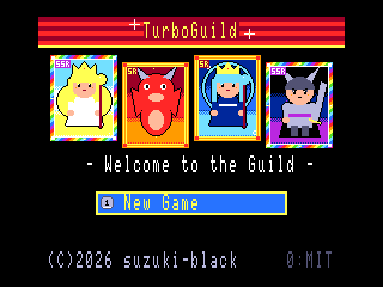
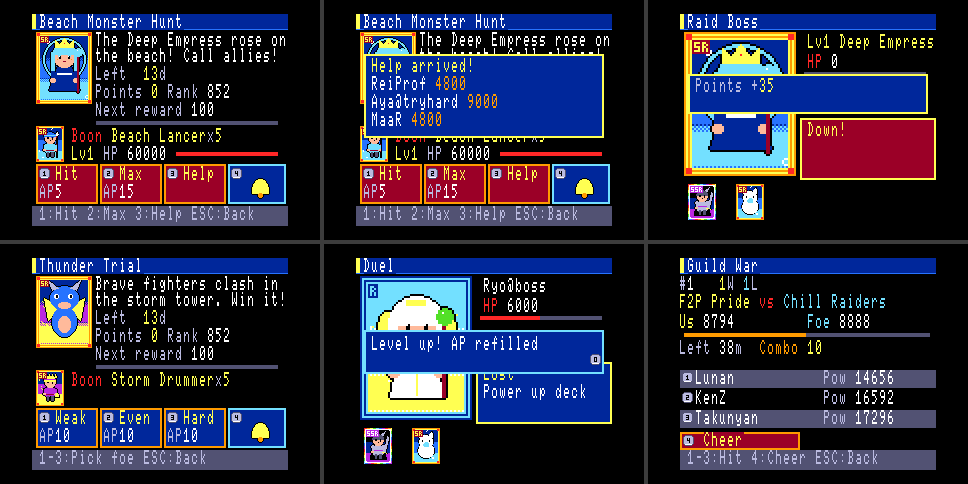
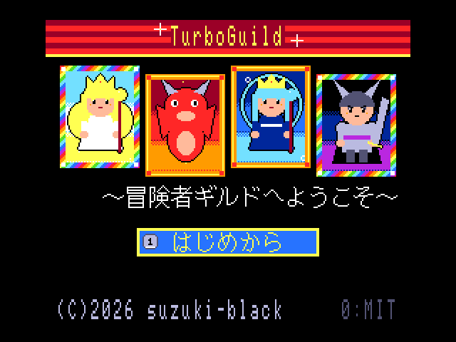

<!-- SPDX-License-Identifier: MIT -->
# TurboGuild

<p align="center">
  
</p>

> ⚠️ **This is a prototype** (work in progress), published for feedback and experimentation.
> It has not been play-tested much yet; numbers and balance will change.
>
> ⚠️ **試作品（プロトタイプ・開発中）です。** フィードバックと実験のために公開しています。
> テストプレイはまだ十分ではありません。数値やバランスは今後変わります。

**Original concept / game design / direction:** suzuki-black　/
**Implementation (program, graphics, sound):** Claude Code (Anthropic Claude)
<br>**原案・コンセプト・ゲームデザイン・ディレクション:** suzuki-black　／
**実装（プログラム・グラフィック・サウンド）:** Claude Code（Anthropic Claude）

**Repository / リポジトリ:** <https://github.com/suzuki-black/TurboGuild>

<p align="center">
  
</p>

**Language / 言語:** [🇬🇧 English](#english) · [🇯🇵 日本語](#japanese)

---

<a name="english"></a>
## English

- [Story](#story)
- [Overview](#overview)
- [Features](#features)
- [Controls](#controls)
- [Requirements](#requirements)
- [Building](#building)
- [Running](#running)
- [Automated checks](#automated-checks)
- [Project structure](#project-structure)
- [Documentation](#documentation)
- [How it got here](#how-it-got-here)
- [Scope & honest positioning](#scope--honest-positioning)
- [Feedback](#feedback--contributing)
- [Credits](#credits)
- [License](#license)
- [Disclaimer](#disclaimer)

### Story

> You are a rookie adventurer walking through the doors of an adventurers' guild.
> The notice board offers daily login bonuses, limited-time events, and a banner that reads
> "SSR rates UP!". At the next table, strangers level up, climb the rankings, and one day quietly vanish.
> This world has an end date — day 270 after launch.
> What kind of adventurer will you be by then?

### Overview
- **Platform:** MSX turboR software (8 Mbit (1 MB) ASCII8 MegaROM + a 2DD floppy used only for saves).
- **Genre:** Single-player RPG that recreates the **Japanese feature-phone social-game culture of around 2011**.
- **Fully offline.** Everything that feels "online" — other players (1,000 NPCs), rankings, operator
  announcements, limited-time events, guild wars — is a simulation derived from the in-game date.
- **Time runs 10× faster than real time.** 27 real days are 270 in-game days, after which the service ends.
  However long you stay away, the results of the events and guild wars you missed appear when you return.

### Features
- **The feel of the era's phones:** menus picked directly with number keys, a "My Page" hub, a scrolling
  news marquee, auto-battles you just watch, and stamina (AP) for exploring.
- **A different opening animation for every gacha** (capsule machine, treasure chest, magic circle, scroll,
  golden door) — guess the rarity from the colour of the light. Events use a **box gacha** (a box of 100 items).
  There is no pity system.
- **War funds.** Instead of real money, an in-game wallet (allowance, salaried worker, oil baron, or
  infinite mode) buys gems. Paying makes you stronger — the social-game logic, without the real cost.
- **120 cards** (procedurally drawn), enhancement and evolution fusion, deck building.
- **Three event types:** hunt (repeatable bosses) / **raid** (a boss whose HP persists until it falls;
  call guild mates for rescue) / **battle** (fight adventurers ranked below, equal to, or above you).
- **Guilds and guild wars.** Twice a day, a one-hour battle window: attack the rival guild, build combos, cheer.
- **An operations timeline:** rate-up campaigns, inflation (newer cards are stronger), apology gems,
  waves of players quitting, the end-of-service notice — and finally the shutdown and staff roll.
- **Rarity inflation every three months:** N / R / SR / SSR at launch, then **USR** on day 90 and **XUSR** on day 180.
  Older rarities become more common in the gacha, and event bosses are tuned for the newest rarity.
- **FM sound (MSX-MUSIC) background music**, 5 tracks (each a 13–26 s loop in four parts).
- The economy is tuned with a **PC-side simulation** (`make sim`): a non-paying player ends with 1–3 cards of SSR or above.

### Controls
| Input | Action |
|------|------|
| Cursor keys / joystick | Select |
| Number keys 0–9 | Pick the button with that number directly (like a phone keypad) |
| Space / Return / trigger A | Confirm; "advance" while exploring |
| ESC / trigger B | Back (deletes a character in name entry) |
| 0 on the title screen | License screen |
| ESC on the title screen | Developer diagnostics |

Title → (New game) name → wallet course → your first 10-pull (re-roll as often as you like) → My Page.
From My Page: quest, gacha, cards, deck, shop, ranking, save, news.
While an event or a guild war is running, enter it from the banner ([9]).

### Requirements
- **MSX turboR only** (FS-A1ST / FS-A1GT). Anything older shows a "turboR only" message and stops.
- For saving, put a physically formatted 2DD floppy in drive A. **The disk is for this game only**
  (writing files to it from DOS destroys the save area). You can play without a disk (saving is disabled).
- The turboR system ROMs are copyrighted and **not included**. Development and checks use
  [openMSX](https://openmsx.org/) with a machine definition based on dumped system ROMs (Panasonic FS-A1ST).
- **Not yet verified on real hardware** (emulator only so far).

### Building
Requires SDCC 4.x (`sdcc`, `sdasz80`), Python 3.11+ (Pillow, for the procedural art), gcc, and GNU make.

```bash
make
```

This produces `bin/TurboGuild.rom` (an 8 Mbit (1 MB) ASCII8 MegaROM) and `bin/save.dsk` (a blank 2DD image).

#### English version

```bash
make LANG=en
```

This produces `bin/TurboGuild_en.rom`. The program is the same as the Japanese one; only the text pages and
the name-entry character table differ.

- Translations live in `data/lang/en.tsv`, one per line: UI strings (`data/text/ui.txt`) as `T_KEY<TAB>English`,
  everything else (card names, events, news, NPC names, ...) as `Japanese<TAB>English`.
- If a translation is missing, the English build stops and writes the missing strings to
  `data/lang/en.missing.tsv`. Fill in the English, move the lines into `en.tsv`, and build again.
- A translation may not be wider than the Japanese (full-width characters count as 2 columns), and some places
  have their own limit (card names: 14 columns, ...). Where the screen has room, a `!` in the third column allows more.
- To add a language, create `data/lang/<lang>.tsv` and build with `make LANG=<lang>` (input-specific code such as
  the name-entry table is switched with `#ifdef LANG_EN`).

Saves record the language and version of the ROM that last saved them, and saves from older versions (v5 and later)
load in newer versions as they are.

### Running
```bash
make run
```

When starting openMSX by hand, always pass `-romtype ASCII8`:

```bash
openmsx -machine Panasonic_FS-A1ST -carta bin/TurboGuild.rom -romtype ASCII8 -diska bin/save.dsk
```

On real hardware, write `bin/TurboGuild.rom` to an ASCII8-capable flash cartridge with the **ASCII8 mapper type**.

### Automated checks
| Command | What it checks |
|---|---|
| `make test` | PC unit tests for `core/` (gacha, battle, fusion, events, raid, battle events, guild war, timeline, saves, …) |
| `make check` | Boot → save → reset → reboot; the RTC difference × 10 is added to in-game time |
| `make check-nodisk` | Boots without a disk and carries on when you try to save |
| `make check-msx2` | Shows "turboR only" and stops on an MSX2 |
| `make play` | Plays automatically for 30 minutes (emulated) from a new game; progress matches across save → reset → load |
| `make check-offline` | After a week away, "Continue" reaches My Page within 3 seconds (measured: 2.66 s) |
| `make check-timeline` | Runs days 0–271: 7 events, 2 guild wars, gifts, the end-of-service notice, and the staff roll |
| `make sim` | Economy simulation: plays 270 days per wallet course and counts cards of SSR or above |

Results are left in `build/run*/` as text and screenshots.

### Project structure
```
src/sys/   hardware layer (boot, VDP, text, kanji ROM, input, PSG, RTC, disk, bank switching)
src/core/  game logic (hardware-independent; unit-tested on the PC)
src/ui/    screens, shared widgets, BGM driver, save-disk handling
src/data/  generated headers (do not edit)
data/      source data (UTF-8 CSV, text, MML)
tools/     Python build tools (data conversion, procedural art, MML, ROM assembly)
tests/     PC unit tests and the economy simulation
openmsx/   Tcl scripts for the automated checks
docs/      design documents and records
```

### Documentation
(The documents are written in Japanese.)
- **[Design document](docs/MSX_turboR_SocialRPG_Design.md)** — the concept.
- **[Implementation spec](IMPLEMENTATION_SPEC.md)** — specification, data formats, formulas, phase plan.
- **[DECISIONS](docs/DECISIONS.md)** — changes from the spec and provisional decisions, one line each.
- **[MEMORY_MAP](docs/MEMORY_MAP.md)** — ROM page allocation (the build assembles the ROM from this table).
- **[Development log](docs/開発記録.md)** — status and checks per phase, and the pitfalls we hit.

### How it got here
Built phase by phase from the design document and the implementation spec.

| Phase | Content |
|---|---|
| 0 | Foundation: ASCII8 MegaROM, H.STKE boot, bank switching, kanji ROM, save disk, RTC |
| 1 | Quests, AP, cards, deck, battle, gacha, login bonus |
| 1.5 | Re-researched the era's phone UIs and made every screen picture-first; gacha opening animations; war funds |
| 2 | Fusion, evolution, events, rankings |
| 3 | Operations timeline, 1,000-NPC pseudo-online world, news, FM music, economy simulation |
| Later | Harder gacha (box gacha, no pity), 120 cards, raid and battle events, guild wars, staff roll |

### Scope & honest positioning
This is an **experimental study**.

- **The theme is recreating the atmosphere of social games of that era**; depth as a game comes second.
  The rankings, the news and your guild mates are all "plausibility" generated from formulas.
- **The numbers have only been tuned once, by the economy simulation**; tuning by actual play is still to come.
- **It has not yet been verified on a real turboR.**
- A full-screen redraw takes about 0.6 s (text and VDP code run from RAM for speed). Heavier logic such as
  the ranking calculations still runs from the cartridge ROM.
- The BGM is driven by the VBLANK interrupt. It pauses only during disk access and resumes where it left off.

### Feedback & Contributing
Please use GitHub Issues for bug reports and impressions. Pull requests with a clear scope are welcome.

### Credits
- **Original concept / game design / direction:** suzuki-black
- **Implementation (program / graphics / sound):** Claude Code (Anthropic Claude)
  — card art and UI parts are procedurally generated, and all music is original; nothing is copied from existing works.
- **Tools:** [SDCC](https://sdcc.sourceforge.net/), [openMSX](https://openmsx.org/), Python (Pillow)

### License
**MIT** © 2026 suzuki-black. See [LICENSE](LICENSE). **Everything in this repository — code, graphics,
music and data — is released under the MIT license.** All assets are original works created for this game;
no rights are reserved beyond the MIT terms. Every source file carries `SPDX-License-Identifier: MIT`.

The ROM contains the SDCC runtime library (GPL with a linking exception, so distributing the ROM is fine).

### Disclaimer
- This is a fictional game. All guilds, adventurers (NPCs), operators and events are fictional and have no
  relation to real people, organisations or games. No specific game's names, characters, images or audio are used.
- "War funds" and "payments" exist only inside the game. **No real money is involved.**
- MSX is a trademark of MSX Licensing Corporation. Other company and product names are trademarks or
  registered trademarks of their respective owners.

---

<a name="japanese"></a>
## 日本語

<p align="center">
  
  
</p>

- [あらすじ](#あらすじ)
- [概要](#概要)
- [特徴](#特徴)
- [操作](#操作)
- [動作環境](#動作環境)
- [ビルド](#ビルド)
- [実行](#実行)
- [自動確認](#自動確認)
- [ディレクトリ構成](#ディレクトリ構成)
- [ドキュメント](#ドキュメント)
- [ここに至るまで](#ここに至るまで)
- [位置づけ（正直な自己評価）](#位置づけ正直な自己評価)
- [フィードバック](#フィードバック)
- [クレジット](#クレジット)
- [ライセンス](#ライセンス)
- [免責](#免責)

### あらすじ

> 新人冒険者のあなたは、とある冒険者ギルドの門をくぐった。
> 掲示板には毎日のログインボーナス、期間限定のイベント、そして「SSR 排出率アップ中！」の張り紙。
> 隣のテーブルでは見知らぬ冒険者たちがレベルを上げ、ランキングを駆け上がり、ある日ふっと姿を消していく。
> この世界には終わりの日が決まっている——サービス開始から 270 日目。
> それまでに、あなたはどんな冒険者になっているだろうか。

### 概要
- **対応機種:** MSX turboR 用ソフト（8メガビット（1MB）の ASCII8 メガROM ＋ セーブ専用の 2DD フロッピー）。
- **ジャンル:** 1人用・「2011 年頃のガラケーソシャゲ文化」を再現した RPG。
- **完全オフライン。** 「オンラインっぽさ」——ほかのプレイヤー（NPC 1000 人）、ランキング、運営のお知らせ、
  期間限定イベント、ギルド対抗戦——は、すべてゲーム内の日付から式で決まるシミュレーションです。
- **時間は現実の 10 倍で進みます。** 現実の 27 日でゲーム内の 270 日が過ぎ、サービスは終了します。
  何日放っておいても、起動すればその間のイベント・対抗戦の結果がまとめて出ます。

### 特徴
- **当時の携帯の手触り。** 数字キーで直接選ぶメニュー、マイページ中心の画面、流れるお知らせ（マーキー）、
  「決定を押したら見ているだけ」の自動戦闘、スタミナ（AP）制の探索。
- **ガチャは種類ごとに違う開封演出**（カプセルマシン・宝箱・魔法陣・巻物・黄金の扉）。
  光の色で中身を察する、あの演出。イベントは **BOX ガチャ**（100 個入りの箱）。天井はありません。
- **軍資金。** 現実のお金の代わりに、ゲームの中のお財布（おこづかい・社会人・石油王・無敵モード）で
  石を買います。課金すれば強くなる——ソシャゲと同じ理屈を、懐を痛めずに味わえます。
- **カード 120 枚**（手続き生成の絵）。強化合成・進化合成・デッキ編成。
- **イベント 3 型:** 討伐（周回ボス）／ **レイド**（倒すまで HP が残るボス、救援依頼でギルドの仲間が削る）／
  **バトル**（格下・同格・格上の冒険者と対戦）。
- **ギルドとギルド対抗戦。** 1 日 2 回の「戦の時間」に相手ギルドを攻撃し、コンボと応援で押し切る。
- **運営年表。** 確率アップ・インフレ（新しいカードほど強い）・お詫びの石・引退の波・終了の告知・
  そしてサービス終了とスタッフロール。
- **3 か月ごとのレア度インフレ。** 開始時は N / R / SR / SSR。90 日目に **USR**、180 日目に **XUSR** が解禁。
  古いレア度ほどガチャで出やすくなり、イベントのボスは最新のレア度を持っている前提の強さになる。
- **FM 音源（MSX-MUSIC）の BGM** 5 曲（各曲 起承転結の 13〜26 秒で 1 周）。
- 経済は **PC 上のシミュレーション**（`make sim`）で合わせています。課金しない人は、終了時に SSR 以上が 1〜3 枚。

### 操作
| 入力 | 動作 |
|------|------|
| カーソルキー／ジョイスティック | 選ぶ |
| 数字キー 0〜9 | ボタンの左上の番号で直接選ぶ（携帯の数字キーのように） |
| スペース／リターン／トリガA | 決定・探索で「進む」 |
| ESC／トリガB | 戻る（名前入力では 1 文字消す） |
| タイトルで 0 | ライセンスの画面 |
| タイトルで ESC | 開発用の診断画面 |

タイトル →（はじめから）名前 → お財布のコース → 最初の 10 連（何度でも引き直せる）→ マイページ。
マイページから 冒険・ガチャ・カード・デッキ・お店・ランク・保存・お知らせ。
イベントやギルド対抗戦の開催中は、バナー（[9]）から入ります。

### 動作環境
- **MSX turboR 専用**（FS-A1ST / FS-A1GT）。turboR 未満では「turboR 専用」と出して止まります。
- セーブには、物理フォーマット済みの 2DD フロッピーを A ドライブに入れてください。
  **このディスクはゲーム専用**です（DOS でファイルを書き込むとセーブ領域を壊します）。ディスクが無くても遊べます（保存はできません）。
- turboR の本体 ROM は著作物のため**同梱していません**。開発と確認は [openMSX](https://openmsx.org/) で、
  本体 ROM を吸い出した機種定義（Panasonic FS-A1ST）を使っています。
- **実機での確認はまだです**（エミュレータでのみ確認しています）。

### ビルド
SDCC 4.x（`sdcc`, `sdasz80`）、Python 3.11 以上（絵の生成に Pillow）、gcc、GNU make が必要です。

```bash
make
```

`bin/TurboGuild.rom`（8メガビット（1MB）の ASCII8 メガROM）と `bin/save.dsk`（空の 2DD）ができます。

#### 英語版

```bash
make LANG=en
```

`bin/TurboGuild_en.rom` ができます。プログラムは日本語版と同じで、文字列のページと名前入力の表だけが違います。

- 訳は `data/lang/en.tsv` の 1 行 1 件です。UI の文（`data/text/ui.txt`）は「`T_キー`⇥英語」、それ以外
  （カード名・イベント・お知らせ・NPC の名前など）は「日本語⇥英語」と書きます。
- 日本語を足したり変えたりして訳が足りなくなると、英語版のビルドは止まり、足りない文を
  `data/lang/en.missing.tsv` に書き出します。英語を書き足して `en.tsv` へ移せば通ります。
- 訳は日本語の幅（全角は 2 桁）を超えられません（カード名は 14 桁など、置き場所ごとの上限もあります）。
  画面で確かめて余裕のある所だけ、3 列目に `!` を書いて超えてよいことにします。
- 言語を足すときは `data/lang/<言語>.tsv` を作り、`make LANG=<言語>` でビルドします
  （名前入力の表など、入力の作りが違う所は `#ifdef LANG_EN` のように切り替えます）。

セーブには、最後に保存した ROM の言語と版が入ります。古い版（v5 以降）のセーブは新しい版でそのまま読めます。

### 実行
```bash
make run
```

手で起動する場合は `-romtype ASCII8` を必ず付けてください:

```bash
openmsx -machine Panasonic_FS-A1ST -carta bin/TurboGuild.rom -romtype ASCII8 -diska bin/save.dsk
```

実機では、ASCII8 対応のフラッシュROMカートリッジに `bin/TurboGuild.rom` を**マッパ種別 ASCII8** で書き込みます。

### 自動確認
| コマンド | 確認すること |
|---|---|
| `make test` | `core/` の PC 単体テスト（ガチャ・戦闘・合成・イベント・レイド・バトル・対抗戦・年表・セーブ など） |
| `make check` | 起動 → 保存 → リセット → 再起動で、RTC の差分 × 10 がゲーム内時間に足される |
| `make check-nodisk` | ディスク無しで起動し、保存しようとしても続行できる |
| `make check-msx2` | MSX2 では「turboR 専用」と出して止まる |
| `make play` | 新規開始から 30 分（エミュレータ時間）自動で遊び、保存 → リセット → 読み込みで進行が一致する |
| `make check-offline` | 1 週間あけて「つづきから」を選び、マイページが出るまで 3 秒以内（実測 2.66 秒） |
| `make check-timeline` | 0〜271 日目まで進め、イベント 7 本・ギルド対抗戦 2 回・贈り物・終了の告知・スタッフロールまで通す |
| `make sim` | 経済シミュレーション。課金コースごとに 270 日遊んで SSR 以上の枚数を数える |

結果は `build/run*/` にテキストとスクリーンショットで残ります。

### ディレクトリ構成
```
src/sys/   ハード依存（起動・VDP・文字・漢字ROM・入力・PSG・RTC・ディスク・バンク切替）
src/core/  ゲームロジック（ハード非依存。PC でテストする）
src/ui/    画面・共通部品・BGM ドライバ・セーブディスク管理
src/data/  生成ヘッダ（手で編集しない）
data/      元データ（UTF-8 の CSV・文言・MML）
tools/     Python のビルドツール（データ変換・絵の手続き生成・MML・ROM の組み立て）
tests/     PC 単体テストと経済シミュレーション
openmsx/   自動確認用の Tcl
docs/      企画書・設計の記録
```

### ドキュメント
- **[企画書](docs/MSX_turboR_SocialRPG_Design.md)** — 何を作るか（コンセプト）。
- **[実装指示書](IMPLEMENTATION_SPEC.md)** — 仕様・データ形式・式・フェーズ計画（企画書と矛盾したらこちらを優先）。
- **[DECISIONS](docs/DECISIONS.md)** — 仕様からの変更と仮決めの記録（1 行 / 件）。
- **[MEMORY_MAP](docs/MEMORY_MAP.md)** — ROM のページ割り当て（ビルドはこの表から組み立てる）。
- **[開発記録](docs/開発記録.md)** — フェーズごとの状況と確認方法、踏んだ地雷。

### ここに至るまで
本作は、企画書と実装指示書をもとに、フェーズを区切って作ってきました。

| フェーズ | 内容 |
|---|---|
| 0 | 土台: ASCII8 メガROM・H.STKE 起動・バンク切替・漢字ROM・セーブディスク・RTC |
| 1 | クエスト・AP・カード・デッキ・戦闘・ガチャ・ログインボーナス |
| 1.5 | 当時の携帯の画面を調べ直し、全画面を「絵が主役」に。ガチャの開封演出。軍資金 |
| 2 | 合成・進化・イベント・ランキング |
| 3 | 運営年表・NPC 1000 人の疑似オンライン・お知らせ・FM 音源・経済シミュレーション |
| 以降 | ガチャを難しく（BOX ガチャ・天井撤廃）、カード 120 枚、レイド・バトル、ギルド対抗戦、スタッフロール |

各フェーズの確認方法と、途中で踏んだ地雷は [開発記録](docs/開発記録.md) にあります。

### 位置づけ（正直な自己評価）
本作は**実験的な習作**です。

- **主題は「当時のソシャゲの空気」の再現**で、ゲームとしての面白さの追求は二の次です。
  ランキングもお知らせもギルドの仲間も、すべて式から作った「それっぽさ」です。
- **数値は経済シミュレーションで一度合わせただけ**です。実際に遊んでの調整はこれからです。
- **実機（turboR）ではまだ確認していません。**
- 画面の描き直しは、全面で 0.6 秒ほどかかります（文字と VDP の処理は RAM で実行して速くしました）。
  ランキングの計算などは、まだカートリッジ ROM の上で動いています。
- BGM は VBLANK 割り込みで鳴らしています。ディスクの読み書きの間だけ止まり、終わると続きから鳴ります。

### フィードバック
不具合報告や感想は GitHub Issues でお願いします。範囲の明確な修正の Pull Request も歓迎します。

### クレジット
- **原案・コンセプト・ゲームデザイン・ディレクション:** suzuki-black
- **実装（プログラム／グラフィック／サウンド）:** Claude Code（Anthropic Claude）
  ― カードの絵・画面部品は手続き生成、BGM はすべてオリジナル。既存作品の絵・楽曲のコピーではありません。
- **制作の道具:** [SDCC](https://sdcc.sourceforge.net/)、[openMSX](https://openmsx.org/)、Python（Pillow）

### ライセンス
**MIT** © 2026 suzuki-black. 詳細は [LICENSE](LICENSE) を参照。**コード・グラフィック・音楽・データを含む
本リポジトリのすべてを MIT ライセンスで公開**します（いずれも本作のために制作したオリジナルで、
MIT の条件を超える権利主張はしません）。各ソースの先頭に `SPDX-License-Identifier: MIT` を入れています。

ROM の中には SDCC のランタイムライブラリが入ります（GPL ＋ リンク例外のため、ROM の配布に問題はありません）。

### 免責
- 本作は架空のゲームです。登場するギルド・冒険者（NPC）・運営・イベントはすべて架空で、
  実在の人物・団体・ゲーム作品とは関係ありません。特定のゲーム作品の名称・キャラクター・画像・音源は使用していません。
- 「軍資金」「課金」はゲームの中だけの数値です。**現実のお金は一切使いません。**
- MSX は MSX Licensing Corporation の商標です。その他の会社名・製品名は各社の商標または登録商標です。
