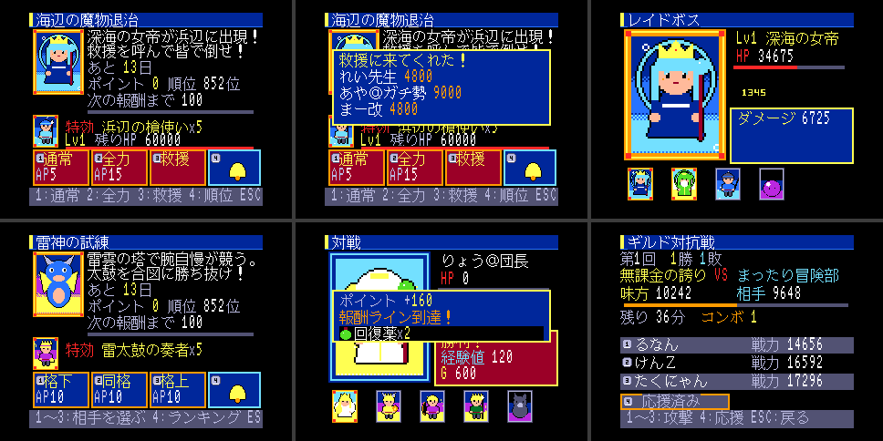

<!-- SPDX-License-Identifier: MIT -->
# 開発記録

フェーズごとの状況と確認方法、踏んだ地雷の記録。README から分けた。
仕様からの変更・仮決めは [DECISIONS.md](DECISIONS.md) に 1 行ずつある。

## 画面づくりの考え方（2010〜2012 年頃の携帯ソシャゲ）

当時の携帯版は「十字キーでリンクを選び、色反転や囲みで選択を示す」「数字キー（accesskey）で直接選べる」
「1 画面は 13 文字 × 10 行ほどの文字と小さな画像・バナー」「リッチな部分（ガチャ・バトル・強化）は Flash 演出」
「決定を押したらあとは見ているだけの自動戦闘」「スタミナで探索・ボス」「マイページ中心」だった。
本作はこれを「絵が主役、文字は添え物」に置き換えている（DECISIONS.md #31〜#38）。
調べた資料: [CEDEC 2011 グリーの講演記事（ファミ通）](https://www.famitsu.com/news/201109/09049960.html)、
[『探検ドリランド』開発者インタビュー（電ファミ）](https://news.denfaminicogamer.jp/interview/200406d/3)、
[ドリランドの思い出（ねとらぼ）](https://nlab.itmedia.co.jp/cont/articles/3293848/)、
[携帯サイトのアクセスキー（All About）](https://allabout.co.jp/gm/gc/24002/2/)。

ガチャは種類ごとに違う開封演出で、光の色が出た中で最も高いレアリティを示す:

| ガチャ | 演出 |
|---|---|
| 無料 | カプセルマシンのハンドルを回し、カプセルが転がり出る |
| ゴールド | 宝箱が揺れて開き、光が立ち上る |
| プレミア | 魔法陣が明滅して光の柱。SSR なら虹色に変わり画面が白く光る（確定演出） |
| チケット | 巻物が広がる |
| SR 確定 | 黄金の扉が開いて白い光があふれる |

## Phase 0 の状況

| 項目 | 状態 | 確認方法 |
|---|---|---|
| `make` で ROM、`make run` で turboR + FDD が起動し SCREEN5 に「TurboGuild」 | 済 | `make check` の `title.png` |
| H.STKE 方式で起動し、HIMEM と空き RAM を表示 | 済 | 診断画面。実測 HIMEM=DE67h、C000h〜HIMEM = 7,783 B |
| バンク切替テスト画面（全ページの見出しを 3 つの窓で照合） | 済 | `bank.png`: 31/31 OK × 3 窓 |
| `sys/` 各モジュールの最小実装と動作確認 | 済 | ROM 内の試験画面で代替（DECISIONS #4） |
| `build_data.py` → `link_rom.py` でカードを ROM から読む | 済 | `cards.png` |
| `tests/` で `core/rng.c` と `core/time.c` が gcc で通る | 済 | `make test` |
| セーブ → リセット → ロードで RTC 差分が加算、ディスク無しでも遊べる | 済 | `make check` / `make check-nodisk` |
| turboR 以外では専用メッセージを出して止まる | 済 | `make check-msx2` |

## Phase 1 の状況

| 項目 | 状態 | 確認方法 |
|---|---|---|
| 500 ステージ自動生成、エリア 5 まで遊べる | 済 | `tools/gen_stages.py`。自動プレイでエリア 10（ステージ 92）まで到達 |
| カード 40 枚、デッキ編成、戦闘式 §6 | 済 | `make test`（戦闘・属性・デッキ）、カード画面 |
| AP 回復、回復薬 | 済 | `make test`（AP）、ショップ・AP 不足時の確認 |
| ガチャ（無料・ゴールド・プレミア＋チケット 2 種）、初回 10 連リセマラ | 済 | `make test`（確率・10 連確定・1 日 1 回。天井は DECISIONS #61 で撤廃） |
| ログインボーナス 7 日 | 済 | `make test`（7 日周期・同じ日は 1 回） |
| 新規開始から 30 分遊んで落ちない。セーブ/ロード往復で所持カード・進行が一致 | 済（エミュレータ） | `make play`: 168 クエスト・46 回の保存→リセット→読み込みが全て一致 |
| 同じことを実機（フラッシュカートリッジ＋FD）で確認 | **未** | 実機が要る |

### Phase 1.5（絵が主役の画面・軍資金）

| 項目 | 状態 | 確認方法 |
|---|---|---|
| 全画面を絵とゲージ主体に（マイページ・探索・ボス戦・ガチャ・カード・デッキ・ログボ・お店・タイトル） | 済 | 紹介画像、`make play` |
| ガチャの種類別の開封演出とカードめくり | 済 | コマ撮りで確認 |
| 数字キーで直接選ぶ | 済 | 各画面のボタン |
| 軍資金・課金ショップ・給料日・無敵モード | 済 | `make test`（wallet）、`make play`（課金して 2000 円使う） |
| 30 分の自動プレイ・保存往復の一致 | 済（エミュレータ） | `make play`: 522 クエスト・40 回の保存→リセット→読み込みが一致 |

### Phase 2（合成・進化・イベント・ランキング）

| 項目 | 状態 | 確認方法 |
|---|---|---|
| 合成・進化 §7、一括素材選択（[1] N を全部） | 済 | `make test`（経験値・同レア +50%・最大 Lv・デッキは素材不可・進化）、画面はカード詳細の [1]/[2] |
| イベント kind=0 を 1 本、14 ゲーム日で開始→終了→報酬配布まで自動 | 済 | `make test`（開幕・報酬ライン・特効・終了・順位報酬・2 度目は何も起きない） |
| ランキング（NPC は静的データ） | 済 | `make test`（順位・一覧の並び）、マイページの [6] とイベント画面の [4] |
| **受け入れ**: イベント期間をまたいだセーブを読み込むと、正しく終了処理と報酬が走る | 済（エミュレータ） | `make play`: 3 日目に参加して戦い、保存→リセット→「20 日目」として読み込み → 最終順位と順位報酬を確認（`EVENT END OK`） |

### Phase 3（運営年表・NPC・お知らせ・FM 音源）

| 項目 | 状態 | 確認方法 |
|---|---|---|
| 運営年表（`data/timeline.csv`）で 0〜270 日目を動かす。お知らせ・イベント 7 本・確率アップ・インフレ・贈り物・引退の波・終了の告知・サービス終了 | 済 | `make test`、`make check-timeline` |
| インフレと新 SSR はデータだけで足す（カードの `release_day`、世代ごとの強さは年表のインフレから自動で決まる） | 済 | `make test`（未登場のカードはガチャ・ドロップに出ない） |
| NPC 1000 人の成長・引退・イベントポイントを式で決める。ランキングは毎回並べ直す。マーキーと「みんなの動き」に流れる | 済 | `make test`、マイページの [6]・[8] |
| FM 音源（OPLL）の BGM 5 曲（マイページ・冒険・ボス・ガチャ・イベント） | 済 | `make run` で聴く |
| **受け入れ**: 課金しない人のサービス終了時の SSR が 1〜3 枚（仕様の 3〜8 枚から下げた） | 済 | `make sim`（中央値 1 枚） |
| イベントガチャは BOX ガチャ（100 個入り・SSR 1）。天井なし・SR 確定チケットは SR だけ・イベントの SSR は 10 位以内の報酬だけ | 済 | `make test`（引き切ると中身どおり・次の箱・イベントが替わると 1 箱目） |
| **受け入れ**: 1 週間ぶりの起動でマイページまで 3 秒以内 | 済（エミュレータ） | `make check-offline`（2.66 秒） |

`make sim` の結果（各 30 回、270 日）:

| コース | SSR 中央値 | 範囲 | 課金(円) |
|---|---|---|---|
| 課金しない | 1 | 0〜4 | 0 |
| おこづかい | 2 | 0〜6 | 27,000 |
| 社会人 | 8 | 5〜12 | 120,000 |
| 石油王 | 13 | 11〜18 | 227,000 |

課金しない人の 3 割ほどは SSR 0 枚で終わる（当時の無課金の感覚）。無敵モードは石油王と同じ引き方なので同じ結果。

### 追加（カード 120 枚・イベント 3 型・ギルド対抗戦）

2010〜2012 年頃の携帯ソシャゲのイベントの分け方（マラソン・レイド・対人戦・ギルド対抗戦）に合わせた。

| 項目 | 状態 | 確認方法 |
|---|---|---|
| カード 65 → 120 枚（N・R・SR・SSR の追加、ギルド対抗戦の報酬カード 4 枚）。絵は手続き生成。ROM を 1MB に | 済 | `make`（絵のページ 30 + 小さい絵 8） |
| イベントの型: 討伐（周回）・レイド・バトル（対人戦）。年表の 7 本に振り分けた | 済 | `make test`（レイド・バトル）、`make check-timeline` |
| レイド: HP は倒すまで残る。通常攻撃（AP 5）と全力攻撃（AP 15・攻撃 3 倍）。倒すと Lv が上がる。救援依頼で同じギルドの仲間が削る | 済 | `make test`、イベント画面の [1]〜[3] |
| バトル: 格下・同格・格上の相手（NPC）を選んで戦う。負けても 1/5 のポイント | 済 | `make test`、イベント画面の [1]〜[3] |
| ギルド: 初めてマイページに来たとき 16 ギルドのどれかに入る | 済 | マイページのお知らせ |
| ギルド対抗戦: 7 日間、1 日 2 回（12 時・21 時から 1 時間）の戦。相手ギルドの冒険者を攻撃（AP 10）、コンボ、応援。勝ち数で順位と報酬 | 済 | `make test`、`make check-timeline`、マイページのバナー [9] |

既知の課題:
- 数値は `make sim` で一度合わせただけ。遊んでみて調整する。
- 文字描画は C で書いていて遅い（名前入力の全面描画で 1 秒弱）。体感が悪ければ RAM 実行の asm に置き換える。
- ~~BGM はメインループで鳴らしているので、長い描画やディスクの読み書きの間は止まる。~~ → 割り込みで鳴らすようにした（DECISIONS #71）。

## 踏んだ地雷（再発させない）

- **REDCLK はメインROMではなく SUB-ROM のエントリ（01F5h）。** メインROMの 01F5h を直接
  `call` すると RDSLT の内部に飛び込み、ページ3 がカートリッジに切り替わって暴走する。
  `ld ix,#0x01F5 / call EXTROM` で呼ぶ。他の SUB-ROM ルーチンも同様。
- **VDP コマンド（HMMV）が走っている間に CPU で VRAM へ書くと、後からコマンドに塗りつぶされる。**
  文字描画の前に S#2 の CE を待つ。
- **SCREEN5 の色 0 は既定で透明**で、周辺色（R#7）が見える。R#8 の TP を立てる。
- **セーブ構造体（882 B）をセクタ単位（512 B × 2）で直接読み書きすると、後ろの RAM 変数まで
  保存・復元される。** リセットしたのにメニュー位置が前回のまま、という形で出た。
  1 セクタずつ `g_sector` 経由でコピーする（`src/ui/savedisk.c`）。
- **起動時に画面部品のアトラスを VRAM に読み込み忘れると、部品が全部ただの四角になる**（`gfx_load_atlas()`）。
- SDCC は小さな定数同士の足し算（124+8 など）を char で畳み、127 を超えると誤検知の警告 158 を出す（値は正しい）。
- SDCC の `--codeseg BANK1` が作る領域名は `_BANK1`。リンカには `-Wl-b_BANK1=0x16010` のように書く。
- **SDCC は別バンクの関数を直接 `call` してもリンクを通す**（24bit 番地の下位 16bit で命令を作る）。
  実行すると今の窓の中の別物に飛ぶ。`FAR` の中継を通し、`tools/check_banks.py` で検査する。
- **EXTROM（CALSLT）は割り込み禁止のまま戻る。** RTC を読んだあと `ei` しないと、
  何も描かない待ち画面で JIFFY が止まり、フレーム待ちで永久に固まる（自動プレイで発覚）。
- 自動テストの「いま押してよいか」の判定に、毎フレーム一瞬しか立たない状態を使うと、
  サンプリングでは見えない。押下待ちの間ずっと立てておく（`g_ui_state`）。
- openMSX の Tcl で `after` から呼ぶ手順に空の要素を混ぜると「invalid command name ""」で
  連鎖が無言で止まる。
- **Z80 で u32 の割り算・掛け算（`__divulong` / `__mullong`）を NPC 1000 人ぶん回すと、起動が 9 秒かかった。**
  プロファイルで見つけ、シフトと足し算に書き換えて 2.66 秒にした。毎回回す式に `%` と `*` を書かない。
- **xor とシフトだけのハッシュは線形なので、種を変えても判定どうしが相関する。** 種を 100 と 101 にしたら
  引退する NPC が極端に少なく、離れた種にしても 2 回目の引退の波が 30% のところ 39% 当たった。
  足し算を混ぜて線形を崩す（`src/core/ranking.c` の `hash`）。
- openMSX は `set throttle off` のままだと `screenshot` が古いフレームを返す。撮るときだけ on にする。
- **整数の式で「/ 100 を先に」書くと、序盤の小さな値が 0 になる**（ギルド対抗戦の攻撃の点が 0 だった）。
  桁あふれしない範囲なら掛けてから割る。
- 自動試験は「押下待ち」（`g_ui_state` が 2）を見たらボタンを押す。お知らせの箱が 1 つ増えるたびに、
  決め打ちの手順の試験が止まった。
- **BGM と効果音をメインループで進めると、長い描画の間だけテンポが崩れる（音が伸びる・ブザーが鳴り続ける）。**
  BGM は VBLANK 割り込み（H.TIMI）へ、効果音は PSG のエンベロープ（ハードが自分で消す）へ移した。
- **割り込みからカートリッジのコードを呼ぶなら、ディスクの読み書きの間は呼ばない。** PHYDIO の間は 4000h に
  ディスク ROM が出ている。H.TIMI はまず RAM の入口へ飛ばし、旗が立っているときだけカーネルを呼ぶ。
- **R800 はカートリッジ ROM のコードが遅い。** 文字と VDP の処理を RAM で実行したら、名前入力の全面描画が
  54 → 37 フレームになった。CPU を DRAM モード（82h）にしても、コードが ROM にある限り速くならなかった。
- 画面の init の途中で「押下待ち」の状態が残っていると、自動試験が前の画面の待ちと見誤って押してしまう。
  画面を替えるときに BUSY にする（`apply_change`）。

